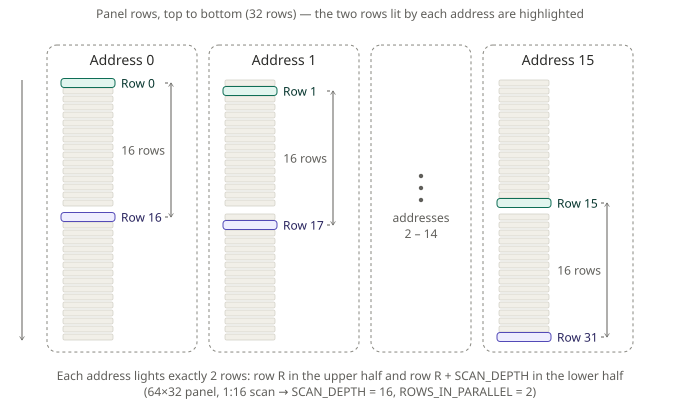
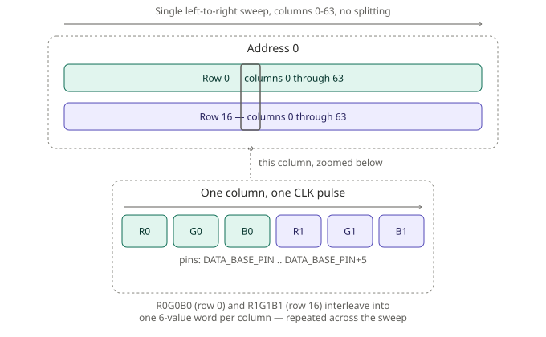

# HUB75 DMA/PIO Driver for Raspberry Pi Pico & Pico 2

**Let DMA and PIO drive your LED matrix – and keep your CPU for the application.**
Once started, the driver streams the panel autonomously; only hardware-triggered IRQ handlers run.

<https://github.com/user-attachments/assets/7c41193c-c724-4fae-8823-af36d70fcedd>

*Demo video: colours are much brighter and more brilliant in reality.*

<!-- TODO: drag assets/icnd2153_pwm.mov into the GitHub README editor (or convert it to .mp4/.gif).
     A relative link to a .mov is only a download link; a user-attachments URL plays inline. -->

## Why this driver?

- **Runs by itself.** DMA chains feed PIO state machines; no bit-banging, no timing loops on your core.
- **Colours that look right.** 10-bit binary code modulation with *balanced light output* (heavy bit-planes are split into slices, which cuts flicker), CIE1931 lightness correction, optional per-channel LUTs and a colour correction matrix.
- **Big and flexible.** Chain panels in serpentine (U-turn) layouts, rotate the display by 0/90/180/270°, or run two independent panels from one RP2350.
- **Configured in one place.** A single [`constexpr Hub75Config`](hub75_demo.cpp#14) is a template argument of [`Hub75Driver<Cfg>`](include/hub75.hpp#95): typos are compile errors, unused code is not built.
- **Many panel types.** From plain 64×64 panels to driver-IC specials, outdoor panels, shift-register panels and PWM panels (see below).

<!-- TODO: add measured numbers here, e.g. refresh rate for 64x64 / 10 bit-planes (frame_rate_debug = true prints it). -->

## What's new

### Shift-register row addressing (e.g. Waveshare Hub75 96×48 SM5368 v2)

Most panels take the row number as a binary address on pins A–E. Some panels instead advance the active row through a **shift register** (SM5368, 74HC595-type row switchers).

See [Settings for a Hub75 Panel with Shift Register for Row Addressing](#settings-for-a-hub75-panel-with-shift-register-for-row-addressing)

### ICND2153-based (S)PWM panels

PWM panels contain driver ICs (ICND2153) that **generate the grey levels themselves** from 16-bit values. The driver therefore does not produce bit-planes for these panels; it builds a 16-bit pixel stream, and the OE pin carries the grey-scale clock (GCLK). Wiring is identical to a standard panel.

See [Settings for a ICND2153 Based PWM Hub75 Panel](#settings-for-a-icnd2153-based-pwm-hub75-panel)

## Supported panels at a glance

| Panel family | Example | Key settings |
|---|---|---|
| Standard HUB75, binary row address | 64×64 (1/32), 64×32 (1/16), 32x16 (1/8 or 1/4) | panel dimensions plus `rowsel_n_pins` |
| HUB75 with special driver IC | P3-64×64-32S (RUL6024), FM6126A panels | `.panel_chip = Hub75PanelChip::RUL6024` / `FM6126A` |
| **New:** shift-register row advance | Waveshare 96×48 SM5368 v2 | `.address_type = RowAddressing::ABCShiftRegister` |
| Outdoor, four rows lit at once | outdoor panel | `.panel_kind = RowMapping::Split` / `S31` |
| **New:** ICND2153 (S)PWM | 128×64 | `.panel_class = PanelClass::PWM`, `.panel_chip = Hub75PanelChip::ICND2153`,`.bitplanes = 16` |

# Quick Start

## Prerequisites

- **Hardware:** Raspberry Pi Pico or Pico W (RP2040), Pico 2 or Pico 2W (RP2350A/B) or compatible board
- **Panel:** HUB75-compatible LED matrix (64×64 default; other sizes configurable)
- **Host OS:** Linux, macOS, or Windows (WSL recommended on Windows)

## Wiring Details

### Default Mapping for HUB75 Connector → Raspberry Pico GPIOs

The diagram shows the default mapping as defined in the hub75.cpp file.
  


### Colour Data Pins

⚠️ It is a requirement of the `Hub75 driver` that the **colour pins** must be arranged in a continuous block in ascending order!

- `pins.data_base_pin` = **GPIO 0** (first in a consecutive block)
- `pins.data_n_pins` = **6** (for R0, G0, B0, R1, G1, B1)

| Hub75 Colour Bit   | connected to      | Pico GPIO |
|:-------------------|-------------------|:-----:|
| R0                 |                   | 0    |
| G0                 |                   | 1    |
| B0                 |                   | 2    |
| R1                 |                   | 3    |
| G1                 |                   | 4    |
| B1                 |                   | 5    |

### Address (Row Select) Pins

⚠️ It is a requirement of the `Hub75 driver` that the **address pins** must be arranged in a continuous block in ascending order!

- `pins.rowsel_base_pin` = **GPIO 6**
- `pins.rowsel_n_pins` = **5** (A0–A4)

| Address bit |  connected to      | Pico GPIO |
| ----------- |--------------------|:---------:|
| A0 (A)      |                    | 6    |
| A1 (B)      |                    | 7    |
| A2 (C)      |                    | 8    |
| A3 (D)      |                    | 9    |
| A4 (E)      |                    | 10   |

### Control Pins

⚠️ It is a requirement of the `Hub75 driver` that the **control pins** must be arranged in a continuous block in ascending order!

- **`pins.clk_pin`** (clock): GPIO 11
- **`pins.strobe_pin`** (latch): GPIO 12
- **`pins.oen_pin`** (output enable): GPIO 13


---

# Configuration in Code

## Overview

Driver configuration now lives in code, as a `constexpr Hub75Config` value passed as a
**template argument** to `Hub75Driver<Cfg>` (see [issue #21](https://github.com/JuPfu/hub75/issues/21)):

```cpp
#include "hub75.hpp"

constexpr Hub75Config panel_cfg{
    .panel = { /* ... */ },
    .screen = { /* ... */ },
    .pins = { /* ... */ },
    .color = { /* ... */ },
    .frame_rate_debug = false,
};

using Panel = Hub75Driver<panel_cfg>;
static Panel driver; // large fixed-size buffers - must have static storage duration
```

This replaces the previous `target_compile_definitions`-based approach. The benefits:

- **Strictly type-checked at compile time** — a typo like `.data_base_pinn = 0` is a compile
  error, not a silently-ignored preprocessor define.
- **No more risk of a stale/forgotten `#ifndef` default** — every field has an explicit,
  visible default in `Hub75Config`'s member-initializers in `hub75.hpp`.
- **Multiple independent configurations in one program** are now possible — each
  `constexpr Hub75Config` instantiates its own `Hub75Driver<Cfg>` type, so you can run two
  differently-configured panels (even two different chains) from a single RP2350. See
  [Dual-Instance Configuration](#dual-instance-configuration).

If a field is **not set** in your `Hub75Config` initializer, it falls back to the **default
value** declared directly in the struct definition in `hub75.hpp` (see
[Notes on Default Values](#notes-on-default-values) below).

A **small number of build-system-level flags** remain in `CMakeLists.txt` — these control how
the project is *built*, not how the panel is *wired or timed*, so they stay as
`target_compile_definitions`: `PICO_RP2350A`, `USE_PICO_GRAPHICS`, and `HUB75_MULTICORE`.
See [Configuration in Code — Quick Reference](#configuration-in-code--quick-reference) for the
complete, current list.

## Configuration Examples  <a id='allowed_deviations_anchor'></a>

Almost all Hub75 driver configuration is done in your application program. See [`hub75_demo.cpp`](hub75_demo.cpp#14) how to set the values of the [`Hub75Config`](include/hub75.hpp#95) structure to your needs.
Configuration details are explained in chapter [Configuration in Code](#configuration-in-code) below. Only a handful of build-system-level flags remain in [`CMakeLists.txt`](CMakeLists.txt).

### CMakeLists.txt Settings for Pico (RP2040) or Pico 2 (RP2430)

The following excerpt from file [`CMakeLists.txt`](CMakeLists.txt) shows that `pico2` is selected as the “Board type”. The `Hub75 driver` uses Pimoroni’s PicoGraphics library (`USE_PICO_GRAPICS`). The `Hub75 driver` runs on the second core `core1` of the `pico2`, while the first core (`core0`) is used by your application logic, which typically draws using Pimoroni’s graphics library.

Here is the default configuration in the [`CMakeLists.txt`](CMakeLists.txt) file that comes with this library.

```cmake

# ⚠️ look at or near line 26
set(PICO_BOARD pico2 CACHE STRING "Board type")  # depending on your pico hardware switch pico 2 (RP2430) to pico (RP2040)

# The following two lines must be uncommented to compile for bare RP2350 without a board
# set(PICO_PLATFORM rp2350)
# set(PICO_BOARD none CACHE STRING "Board type")

# ⚠️ look at or near line 78
target_compile_definitions(hub75_demo PRIVATE
    # PICO_RP2350A=0             # uncomment for RP2350B microcontrollers only
    USE_PICO_GRAPHICS=true       # set to false if you use hub75 as a library
    HUB75_MULTICORE=true         # use core1 for the hub75 driver
)
```

### Driver Configuration for Pico (RP2040) or Pico 2 (RP2430)
As mentioned earlier, the rest of your panel’s configuration is done in your application program. This is easier than it seems at first glance! The `Hub75 driver` has default values for all attributes. You only need to change an attribute if it does not match this default value. If you have a “standard” Hub75 matrix panel with 64 rows and 64 columns and have chosen to wire the pins as described earlier, you do not need to specify a single attribute, since the fallbacks in the `Hub75 driver` have already preset them accordingly. Your configuration therefore reduces to the minimal case listed here

```cpp
constexpr Hub75Config panel_cfg{};
```

If you have a "standard" 64x32 panel it is sufficient to set the configuration to

```cpp
constexpr Hub75Config panel_cfg{
    .panel = {
        .matrix_panel_width = 64,      // your matrix panel width - this line could be dropped as 64 columns is the hub75 drivers default
        .matrix_panel_height = 32,     // your matrix panel height - differs from the default value of 64
    },
};
```

as panel dimensions 64x64 (64 rows and 64 columns) is the default.

## Overview of Driver Configuration Attributes

To give you an overview of the available options let's show them all in brief (details in [Configuration in Code](#configuration-in-code)). Look at the start of `hub75_demo.cpp` to see how it is used. 
 
```cpp
// hub75_demo.cpp / your own .cpp file
constexpr Hub75Config panel_cfg{
    .panel = {
        .matrix_panel_width = 64,                  // your matrix panel width
        .matrix_panel_height = 64,                 // your matrix panel height
        .chain_rows = 1,                           // number of chain rows stacked vertically (rows)
        .chain_cols = 1,                           // number of panels chained left-to-right in a single chain row (columns)
        .panel_class = PanelClass::HUB75,          // standard HUB75 panel - another value is PWM
        .chain_mode = Hub75ChainMode::SERPENTINE,  // default is serpentine (U-Turn with compensation for 180° rotation)
        .panel_kind = RowMapping::Standard,        // how to map the rgb888 buffer onto the panel 
        .address_type = RowAddressing::Binary,     // row addressing via address pins
        .scan_mode = 0,                            // 0 tries to automatically deduce scan_mode else specify a value
        .panel_chip = Hub75PanelChip::GENERIC,     // mainly used for initialisation sequence but also for panel specific characteristics
        .pwm_reverse_chain_order = false,          // PWM panels only - reverse the order of the panels inside a chain
        .inverted_stb = false,                     // inverted pin signal for strobe (latch) pin
        .sm_clockdiv_factor = 1.0f,                // the driver is fast - to prevent flicker or ghosting it might be worth a try to reduce state machine speed
        .base_latch_ns = 180,                      // wait time in nano-seconds to stabilise latch
        .base_addr_ns = 260,                       // wait time in nano-seconds to stabilise row addressing
    },
    .screen = {
        .rotation = Hub75Rotation::DEG_0,          // display rotation (DEG_0, DEG_90, DEG_180 or DEG_270)
    },
    .pins = {
        .data_base_pin = 0,                        // base GPIO pin (aka start index) of R0, G0, B0, R1, G1, B1 GPIO pins
        .data_n_pins = 6,                          // number (count) of colour pins (usually 6: R0, G0, B0, R1, G1, B1)
        .rowsel_base_pin = 6,                      // base GPIO row select pin (aka start index) of A, B (, C, D. E) GPIO pins
        .rowsel_n_pins = 5,                        // row select pin count 
        .clk_pin = 11,                             // GPIO pin for CLK 
        .strobe_pin = 12,                          // GPIO pin for STROBE (LATCH)
        .oen_pin = 13,                             // GPIO for OE pin (GCKL for PWM panel class)
    },
    .color = {
        .bitplanes = 10,               // number (count) of bit-planes used for BCM (Binary Code Modulation) - valid values are 8, 10 for HUB75 panels and 16 for PWM panels
        .separate_cie_channels = true, // use separate CIE channels for improved colour representation - needs more memory
        .balanced_light_output = true, // improves image quality but needs some more memory
        .swap_rb_pins = false,         // swap red and blue pins in software
        .ccm_rg_shift = 6,             // CCM Cross-channel mixing - mix ~1.6% green into the red channel
        .ccm_gb_shift = 7,             // CCM Cross-channel mixing - mix ~0.8% blue into the green channel
    },
    .frame_rate_debug = false,         // for testing and debugging purpose only: output frame rate information (printf) e.g. in VS Code monitor - set to `false` for production
};
```

### CMakeLists.txt Settings for RP2350B

To use a `RP2350B` microcontroller adapt `CMakeLists.txt` as shown below.

```cmake
# ⚠️ look at or near line 26
# set(PICO_BOARD pico2 CACHE STRING "Board type")

# The following two lines must be uncommented to compile for bare RP2350 without a board
set(PICO_PLATFORM rp2350)
set(PICO_BOARD none CACHE STRING "Board type")

# ⚠️ look at or near line 78
target_compile_definitions(hub75_demo PRIVATE
    PICO_RP2350A=0               # uncomment for RP2350B microcontrollers only
    USE_PICO_GRAPHICS=true       # set to false if you use hub75 as a library
    HUB75_MULTICORE=true         # use core1 for the hub75 driver
)
```

### Driver Configuration for RP2350B

Since the `RP2350B` microcontroller has more pins available as the `pico2` in this example we use pins 30 up to pin 43 to connect to the matrix panel.

```cpp
constexpr Hub75Config panel_cfg{
    .panel = {
        .matrix_panel_width = 64,   // your matrix panel width
        .matrix_panel_height = 64,  // your matrix panel height
    },
    .pins = {
        .data_base_pin = 30,        // base GPIO pin (aka start index) of R0, G0, B0, R1, G1, B1 GPIO pins
        .data_n_pins = 6,           // number (count) of colour pins (usually 6: R0, G0, B0, R1, G1, B1)
        .rowsel_base_pin = 36,      // base GPIO row select pin (aka start index) of A, B (, C, D. E) GPIO pins
        .rowsel_n_pins = 5,         // row select pin count 
        .clk_pin = 41,              // GPIO pin for CLK 
        .strobe_pin = 42,           // GPIO pin for STROBE (LATCH)
        .oen_pin = 43,              // GPIO for OE pin (GCKL for PWM panel class)
    },
};
```

### Settings for a Hub75 Panel with Shift Register for Row Addressing

In standard HUB75 panels, the address pins (A, B, C, D, E) are usually used as binary address lines.
**Waveshares** matrix panel `Hub75 96x48 SM5368 Version 2`, for example, does not operate according to this scheme, but uses a shift register to advance to the next row.
This means that it does not output the address of the current row directly, but rather advances the row selection to the next row via a shift sequence.
This requires a dedicated row control logic. To advise the `Hub75 driver` to use this dedicated control logic set `.address_type = RowAddressing::ABCShiftRegister`.

We do not have any **Waveshare** panels at hand. User [Jason](https://github.com/jason-a69) was kind enough to carry out some basic testing of the `Hub75 96x48 SM5368 Version 2` panel. As [Jason](https://github.com/jason-a69) pointed out, he had to reduce the state machine (sm) clock `.sm_clockdiv_factor = 4.0f` to achieve a stable output. Currently testing and optimising of this panel is at rest due to missing hardware.

```cpp
constexpr Hub75Config panel_cfg{
    .panel = {
        .matrix_panel_width = 96,                  // your matrix panel width
        .matrix_panel_height = 48,                 // your matrix panel height
        .address_type = RowAddressing::ABCShiftRegister, // row addressing via shift register
        .scan_mode = 24,                           // 0: try to automatically deduce scan_mode - <value>: take value as scan_mode
        .sm_clockdiv_factor = 4.0f,                // the driver is fast - to prevent flicker or ghosting it might be worth a try to reduce state machine speed
     },
    .color = {
        .bitplanes = 10,                           // number (count) of bit-planes used for BCM (Binary Code Modulation)
        .balanced_light_output = true,             // improves image quality but needs some more memory
        .swap_rb_pins = true,                      // swap red and blue pins in software
    },
}
```
### Settings for a ICND2153 Based PWM Hub75 Panel

PWM modules generate the pulse width modulation themselves – in contrast, the BCM (Binary Coded Modulation), including the balanced light output, is generated by the `Hub75 driver` for Hub75 panels (`.panel_class = PanelClass::HUB75`). The `Hub75 driver` implementation for the ICND2153 PWM panel therefore is different. This is reflected in three configuration attributes `.panel_class = PanelClass::PWM`, `.panel_chip = Hub75PanelChip::ICND2153`. and `.bitplanes = 16`.

```cpp
constexpr Hub75Config panel_cfg{
    .panel = {
        .matrix_panel_width = 128,                 // your matrix panel width
        .matrix_panel_height = 64,                 // your matrix panel height
        .panel_class = PanelClass::PWM,            // it's a PWM panel
        .address_type = RowAddressing::Binary,     // row addressing via address pins
        .panel_chip = Hub75PanelChip::ICND2153,    // mainly used for initialisation sequence but also for panel specific characteristics
        .pwm_reverse_chain_order = false           // PWM panels only - reverse the order of the panels inside a chain
     },
    .color = {
        .bitplanes = 16,                           // number (count) of bit-planes for a ICND2153 PWM panel
        .separate_cie_channels = true,             // use separate CIE channels for improved colour representation - needs more memory
        .balanced_light_output = true,             // ⚠️ setting is ignored for PWM panels  
     },
    .frame_rate_debug = false,                     // for testing and debugging purpose only: output frame rate information (printf) e.g. in VS Code monitor - set to `false` for production
};
```

**Tested panel:** XR1.875-128x64-1515-32S-4L-V3.0 (128×64, 1/32 scan).

**Memory:** this configuration needs ample memory – a Pico (RP2040) might do but plan for an Pico 2 (RP2350). Chaining of two such panels should work for Pico 2 but is not verified.

If the panels of a chain appear in the wrong order, set `.pwm_reverse_chain_order = true`.

 
## How to Use This Project in VSCode

You can easily use this project with VSCode, especially with the **Raspberry Pi Pico plugin** installed. Follow these steps:

1. **Open VSCode and start a new window**.
2. **Clone the repository**:
   - Press `Ctrl+Shift+P` and select `Git: Clone`.
   - Paste the URL: `https://github.com/JuPfu/hub75`

      

   - Choose a local directory to clone the repository into.

      

3. **Project Import Prompt**:
   - Consent to open the project.

      

   - When prompted, "Do you want to import this project as Raspberry Pi Pico project?", click **Yes** or wait a few seconds until the dialog prompt disappears by itself.

4. **Configure Pico SDK Settings**:
   - A settings page will open automatically.
   - Use the default settings unless you have a specific setup.

      

   - Click **Import** to finalize project setup.
   - Switch the board-type to your Pico model.

      

5. **Wait for Setup Completion**:
   - VSCode will download required tools, the Pico SDK, and any plugins.

6. **Connect the Hardware**:
   - Make sure the HUB75 LED matrix is properly connected to the Raspberry Pi Pico.
   - Attach the Rasberry Pi Pico USB cable to your computer

7. **Build and Upload**:
   - Compiling the project can be done without a Pico attached to the computer.

      

   - Click the **Run** button in the bottom taskbar.
   - VSCode will compile and upload the firmware to your Pico board.

> 💡 If everything is set up correctly, your matrix should come to life

## Where to go next

To explore the architectural details of the `Hub75 driver` see
- [Hub75 Matrix Panel Driver Version 3.0](docs/Hub75%20Matrix%20Panel%20Driver%20Version%203.0.md)

If you're interested in specific details — such as how to improve print quality or configure chained panels — the following links should help you explore the capabilities of the `Hub75 driver`
- [Configuration reference](docs/configuration.md) – reference for all attributes
- [Pixel mapping](docs/pixel-mapping.md) – `RowMapping::Standard`, `Split`, `S31`
- [Colour pipeline](docs/colour.md) – balanced light output, CIE1931, colour correction matrix, brightness
- [Chained panels and rotation](docs/chaining-and-rotation.md) - topology of chained panels and software rotation of the displayed image
- [Dual Panel Instances](docs/dual-instances.md) - 2 independently attached Hub75 panels driven by this `Hub75 driver`
- [Tested boards](docs/boards.md)
- [Troubleshooting](docs/troubleshooting.md)

---

## Demo Effects

The demo effects in `hub75_demo.cpp` are included to exercise the driver and showcase colour fidelity. They cycle automatically; press the button to advance to the next effect.

| # | Effect | Purpose |
|---|--------|---------|
| 0 | Bouncing balls with text | Tests real-time animation; text position is hard-coded for 64×64 |
| 1 | Fire effect | Demonstrates per-pixel colour blending at high refresh rates |
| 2 | Static 64×64 images | Verify colour accuracy and panel mapping on the reference panel size |
| 3 | Rotator | Geometric transformation test - rotating antialiased line |
| 4 | Analog clock | Geometric transformation test - application of multiple rotating antialiased lines|
| 5 | Colour gradient / plasma | Full-spectrum colour coverage |
| 6 | Straight lines | Helps to detect mapping errors |
| 7 | Grey-scale ramp | **Calibration tool** — equal R, G, B at every luminance step. Use this with the [CCM Tuning Procedure](docs/colour.md#tuning-procedure) to eliminate colour tints |

> ⚠️ The demo has been tested on a **Raspberry Pi Pico 2 RP2350A** and **Raspberry Pi Pico 2 RP2350B**. On a RP2040 you may need to comment out some effects due to tighter memory constraints. Open an issue if you need help.

## Next Steps

The core driver pipeline is stable. Possible future directions include:

- **Additional panel mappings** — contributions for panels with unusual internal wiring (e.g. serpentine, split-scan) are welcome.
- **RP2040 memory optimisations** — the `color.separate_cie_channels`, `color.balanced_light_output`, and `color.bitplanes` fields already allow memory/quality trade-offs; further tuning for constrained targets is an open area.

For questions, bug reports, or feature discussions, feel free to open an issue on [GitHub](https://github.com/JuPfu/hub75).

---

### Configuration Examples

The examples below cover the most common panel types. For each one, only `panel.matrix_panel_width`, `panel.matrix_panel_height`, `panel.panel_kind`, and `pins.rowsel_n_pins` need to be set — everything else falls back to the defaults.

```cpp
// Example for a 64×64 panel (1/32 scan) - 2 rows lit simultaneously
constexpr Hub75Config cfg_64x64_2row{
    .panel = {
        .matrix_panel_width = 64,
        .matrix_panel_height = 64,
        .panel_kind = RowMapping::Standard,
    },
    // Set the number of address lines - 2 rows lit simultaneously leaves 32 rows to be adressed via row select.
    // That is 32 = 2 to the power of 5 - we need 5 row select pins
    .pins = { .rowsel_n_pins = 5 },
};


// Example for a 64×32 panel (1/16 scan) - 2 rows lit simultaneously
constexpr Hub75Config cfg_64x32_2row{
    .panel = {
        .matrix_panel_width = 64,
        .matrix_panel_height = 32,
        .panel_kind = RowMapping::Standard,
    },
    // Set the number of address lines - 2 rows lit simultaneously leaves 16 rows to be adressed via row select.
    // That is 16 equals 2 to the power of 4 - we need 4 row select pins
    .pins = { .rowsel_n_pins = 4 },
};


// Example for a 32×16 panel (1/8 scan) - 2 rows lit simultaneously
constexpr Hub75Config cfg_32x16_2row{
    .panel = {
        .matrix_panel_width = 32,
        .matrix_panel_height = 16,
        .panel_kind = RowMapping::Standard,
    },
    // Set the number of address lines - 2 rows lit simultaneously leaves 8 rows to be adressed via row select.
    // That is 8 equals 2 to the power of 3 - we need 3 row select pins
    .pins = { .rowsel_n_pins = 3 },
};


// Example for a 64×64 panel (1/16 scan) - 4 rows lit simultaneously
constexpr Hub75Config cfg_64x64_4row{
    .panel = {
        .matrix_panel_width = 64,
        .matrix_panel_height = 64,
        .panel_kind = RowMapping::S31,
        // If ghosting or flicker occurs, try increasing sm_clockdiv_factor (see Step 6)
        .sm_clockdiv_factor = 1.0f,
    },
    // Set the number of address lines - 4 rows lit simultaneously leaves 16 rows to be adressed via row select.
    // That is 16 equals = 2 to the power of 4 - we need 4 row select pins
    .pins = { .rowsel_n_pins = 4 },
};


// Example for a 32×16 panel (1/4 scan) - 4 rows lit simultaneously
constexpr Hub75Config cfg_32x16_4row{
    .panel = {
        .matrix_panel_width = 32,
        .matrix_panel_height = 16,
        .panel_kind = RowMapping::Split,
        // If ghosting or flicker occurs, try increasing sm_clockdiv_factor (see Step 6)
        .sm_clockdiv_factor = 1.0f,
    },
    // Set the number of address lines - 4 rows lit simultaneously leaves 4 rows to be adressed via row select.
    // That is 4 equals 2 to the power of 2 -> we need 2 row select pins
    .pins = { .rowsel_n_pins = 2 },
};
```

Note that the panel name usually does not encode the internal pixel wiring or the driver IC type.
These must be determined visually or experimentally.
But sometimes the name of the panel gives you a lot of information how the configuration has to be done.
Here an example for a **P3-64*64-32S-V2.0** panel.

```cpp
constexpr Hub75Config panel_cfg{
    // Width and height are encoded in the panel name
    .panel = {
        .matrix_panel_width = 64,
        .matrix_panel_height = 64,

        // The 32S in the panel name refers to (1/32 scan) - 2 rows lit simultaneously
        // We can try the standard pixel mapping - maybe we are lucky and the pixel mapping fits
        .panel_kind = RowMapping::Standard,

        // Look at the back of the panel. If you detect a chip which is labeled RUL6024
        // then set the appropriate panel chip
        .panel_chip = Hub75PanelChip::RUL6024,
    },
    // Set the number of address lines - 2 rows lit simultaneously leaves 32 rows to be adressed via row select.
    // That is 32 equals 2 to the power of 5 -> we need 5 row select pins (as might be printed on the panel backside - A, B, C, D, E)
    .pins = { .rowsel_n_pins = 5 },
};
```

---

### Pixel Mapping

Each panel type has it's own pixel mapping.

#### How Pixel Mapping Works (General Idea)

HUB75 panels do not accept pixels in simple row-major order.

Instead, pixel data is shifted into the panel in the exact order expected by the
panel's internal shift registers and multiplexing logic.

Key properties:

- Pixels are shifted **column-wise**, not row-wise
- Multiple physical rows are driven **simultaneously**
- The shift buffer therefore always contains pixels from **different vertical regions**
- The exact ordering depends on:
  - how many rows are multiplexed
  - how the panel internally wires its row drivers

Each mapping describes how pixels from the linear source buffer (`src`) are reordered into the panel's shift buffer (`frame_buffer_`).

### Practical Notes

Not all of the demo effects will show correctly for matrix panels with a format different to 64x64 pixels. The first two demo effects use image data for a 64x64 layout. You will see some output, but it will look weird.

The `bouncing balls` effect will not show the complete text as the position is hard coded. The `fire_effect` and the `rotator`might look as they should be.

Have fun with adapting the source code or with implementing your own effects.

Do not hesitate to contact me - I will gladly answer your questions!

---

# Troubleshooting

If your panel does not behave as expected, do **not** change multiple configuration options at once.
Most issues can be isolated by checking **one dimension at a time**.

The sections below are ordered from **most common** to **least common** problems.

---

## 1. Panel Stays Completely Dark

### Check the obvious first

* Is the panel powered with the **correct voltage** (usually 5 V)?
* Is the power supply strong enough (HUB75 panels can draw several amps)?
* Is `pins.oen_pin` wired correctly and not permanently disabling output?

### Configuration checks

* Verify `panel.matrix_panel_width` and `panel.matrix_panel_height`
* Verify `pins.rowsel_n_pins` matches the number of address pins on the panel (A, B, C, …)

If `pins.rowsel_n_pins` is too large or too small, **no rows will be selected correctly**.

---

## 2. Panel Lights Up, But Only Shows Noise or Garbage

This usually indicates a **pixel mapping mismatch**.

### What to check

* Try a different `panel_kind` value:

  ```cpp
  .panel_kind = RowMapping::Standard,
  // .panel_kind = RowMapping::Split,
  // .panel_kind = RowMapping::S31,
  ```

### Typical symptoms

| Symptom                       | Likely cause                     |
| ----------------------------- | -------------------------------- |
| Completely scrambled image    | Wrong `panel_kind`               |
| Image mirrored or interleaved | Wrong internal wiring assumption |
| Repeating blocks or patterns  | Mapping partially correct        |

> 💡 If the image is *stable but wrong*, the scan rate is likely correct and only the mapping needs adjustment.

---

## 3. Image Looks Correct, But Rows Are Missing or Repeated

This usually points to a **row addressing issue**.

### Check

* `pins.rowsel_n_pins`
* Panel height (`panel.matrix_panel_height`)

### Rule reminder

```
multiplexed_rows = matrix_panel_height / 2^rowsel_n_pins
```

If this value does not match the panel's actual multiplexing, rows will be:

* skipped
* duplicated
* shifted

---

## 4. Image Is Correct but Flickers or Shows Ghosting

This is typically a **timing issue**.

### Things to try

1. Tune `sm_clockdiv_factor`:

   ```cpp
   .panel = { .sm_clockdiv_factor = 1.0f },
   ```

2. Increase the divider if necessary:

   * ≤ 16 rows → try `8.0f`
   * ≤ 32 rows → try `2.0f` or `4.0f`

### Also check

* Power supply quality
* Cable length and signal integrity
* Ground connection between MCU and panel

---

## 5. Panel Updates Sporadically or Only Every Few Frames

This often indicates **strobe polarity mismatch**.

Try

```cpp
.panel = { .inverted_stb = true },
```

If the panel suddenly becomes stable, the latch signal is inverted on your board.

---

## 6. Colors Look Wrong or Are Too Dim / Too Bright

### Check

* Panel driver chip type:

  ```cpp
  .panel_chip = Hub75PanelChip::GENERIC,
  // .panel_chip = Hub75PanelChip::FM6126A,
  // .panel_chip = Hub75PanelChip::RUL6024,
  ```

If the panel contains an FM6126A or RUL6024 chip and is not initialized correctly:

* brightness may be wrong
* colors may look distorted
* output may be unstable

### How to verify

* Inspect the **back of the panel**
* Look for chip markings (FM6126A, RUL6024)

---

## 7. When Nothing Makes Sense Anymore 😄

Follow this **minimal recovery procedure**:

1. Use the simplest known-good configuration:

   ```cpp
   .panel_kind = RowMapping::Standard,   // driver default
   ```

2. Verify:

   * correct width and height
   * correct `pins.rowsel_n_pins`

3. Use a **simple test pattern**:

   * solid colors
   * vertical and horizontal stripes

4. Change **one parameter at a time**

---
# Boards

This section lists every LED matrix panel used during development and testing of this library. Each entry documents the panel hardware, its key electrical characteristics, the pixel mapping it requires, and a ready-to-paste `Hub75Config` configuration block.

> 💡 **Adding your own panel?** Use the template at the end of this section. Copy an existing entry whose scan rate and pixel mapping are closest to yours, adjust the values, and open a pull request — contributions welcome!

---

## Overview

| # | Panel label | Dimensions | Scan / rows lit | `panel_kind` | Driver chip(s) | `panel_chip` |
|:---:|---|:---:|:---:|---|---|---|
| [1](#1-p3qd-64x64-21--p3-64x64-2012-21a-10) | P3QD-64x64-21 | 64 × 64 | 1/32 S · 2 rows | `RowMapping::Standard` | RUC7258D, FM6124DJ | `Hub75PanelChip::GENERIC` |
| [2](#2-p3-64x64-32s-v20--2310p3) | P3-64x64-32S-V2.0 | 64 × 64 | 1/32 S · 2 rows | `RowMapping::Standard` | RUC7258D, RUL6024 | `Hub75PanelChip::RUL6024` |
| [3](#3-qp3-outdoor--p3-1415-rowmappings31) | QP3 Outdoor P3-1415 | 64 × 64 | 1/16 S · 4 rows | `RowMapping::S31` | DP5125D | `Hub75PanelChip::GENERIC` |
| [4](#4-p10-smd-16x32-b-rowmappingsplit) | P10-SMD-16x32-b | 16 × 32 | 1/4 S · 4 rows | `RowMapping::Split` | DP5020B | `Hub75PanelChip::GENERIC` |

---

## 1. P3QD-64x64-21 / P3-64x64-2012-21A-1.0 (`ROW_MAP_STANDARD`)

### Hardware

| Property | Value |
|---|---|
| Dimensions | 64 × 64 pixels |
| LED pitch | P3 (3 mm) |
| Scan rate | 1/32 S — **2 rows lit simultaneously** |
| Address pins | 5 (A, B, C, D, E) |
| Driver ICs | RUC7258D, FM6124DJ |
| Panel type | Indoor |
| BCM mode | Plane-wise |

### Pixel Mapping

Standard two-row multiplexing. Upper and lower halves are interleaved column by column.
Use `RowMapping::Standard` (this is also the default when `panel_kind` is not set).

### Configuration

```cpp
constexpr Hub75Config panel_cfg{
    .panel = {
        .matrix_panel_width = 64,           // panel width in pixels
        .matrix_panel_height = 64,          // panel height in pixels
        .panel_kind = RowMapping::Standard,
        .panel_chip = Hub75PanelChip::GENERIC,
        .inverted_stb = false,
        .sm_clockdiv_factor = 1.0f,
        .base_latch_ns = 80,
        .base_addr_ns = 160,
    },
    .pins = {
        .data_base_pin = 0,                 // first colour data GPIO (R0)
        .data_n_pins = 6,                   // R0 G0 B0 R1 G1 B1
        .rowsel_base_pin = 6,                // first address GPIO (A)
        .rowsel_n_pins = 5,                  // A B C D E — 5 pins for 1/32 scan
        .clk_pin = 11,
        .strobe_pin = 12,
        .oen_pin = 13,
    },
    .color = {
        .bitplanes = 10,
        .balanced_light_output = true,
        .separate_cie_channels = true,
    },
    .frame_rate_debug = false,              // set to true only for debugging
};

using Panel = Hub75Driver<panel_cfg>;
```

`HUB75_MULTICORE=true` remains a `CMakeLists.txt` build flag — see
[Remaining `CMakeLists.txt` Build Flags](#remaining-cmakeliststxt-build-flags).

> 💡 `RowMapping::Standard` is the driver default and does not need to be set
> explicitly unless you are switching from a different mapping.

---

## 2. P3-64x64-32S-V2.0 / 2310P3

### Hardware

| Property | Value |
|---|---|
| Dimensions | 64 × 64 pixels |
| LED pitch | P3 (3 mm) |
| Scan rate | 1/32 S — **2 rows lit simultaneously** |
| Address pins | 5 (A, B, C, D, E) |
| Driver ICs | RUC7258D, **RUL6024** |
| Panel type | Indoor |
| BCM mode | Plane-wise |

### Pixel Mapping

Same two-row multiplexing as board 1. The difference is the RUL6024 driver IC, which
requires a dedicated initialisation sequence — set `panel_chip = Hub75PanelChip::RUL6024`.
Forgetting this causes incorrect brightness or distorted colours even though the pixel
mapping itself is identical to `Hub75PanelChip::GENERIC` panels.

> ⚠️ **How to identify the RUL6024:** Inspect the back of the panel. The chip is
> typically the largest IC on the PCB and is marked `RUL6024`. If in doubt, start with
> `Hub75PanelChip::GENERIC`; the worst outcome is incorrect brightness, not panel damage.

### Configuration

```cpp
constexpr Hub75Config panel_cfg{
    .panel = {
        .matrix_panel_width = 64,
        .matrix_panel_height = 64,
        .panel_kind = RowMapping::Standard,
        .panel_chip = Hub75PanelChip::RUL6024,   // ← required for RUL6024 init sequence
        .inverted_stb = false,
        .sm_clockdiv_factor = 1.0f,
        .base_latch_ns = 80,
        .base_addr_ns = 160,
    },
    .pins = {
        .data_base_pin = 0,
        .data_n_pins = 6,
        .rowsel_base_pin = 6,
        .rowsel_n_pins = 5,                      // A B C D E — 5 pins for 1/32 scan
        .clk_pin = 11,
        .strobe_pin = 12,
        .oen_pin = 13,
    },
    .color = {
        .bitplanes = 10,
        .balanced_light_output = true,
        .separate_cie_channels = true,
    },
    .frame_rate_debug = false,
};

using Panel = Hub75Driver<panel_cfg>;
```

### `ROW_MAP_STANDARD` — pixel mapping topology

Standard addressing (`ROW_MAPPING=ROW_MAP_STANDARD`) is the simpler of the two schemes and the one most indoor HUB75 panels use. 
Each row-select address lights exactly `ROWS_IN_PARALLEL` rows at once — 2 for the common case — and the panel's full width is written in a single continuous pass,
with no column splitting. This section uses a 64×32 panel at 1:16 scan (`ROWSEL_N_PINS=4`, 16 addresses, `ROWS_IN_PARALLEL=2`) as a concrete example
- scale the numbers to your own `MATRIX_PANEL_WIDTH`/`MATRIX_PANEL_HEIGHT`/`ROWSEL_N_PINS`.

#### 1. Which rows share an address

Each row-select address drives exactly 2 rows, `SCAN_DEPTH` apart.

| Address | Rows driven simultaneously |
|---|---|
| 0 | 0, 16 |
| 1 | 1, 17 |
| ⋮ | ⋮ |
| 15 | 15, 31 |



In general: `address = row % SCAN_DEPTH`, and the rows for address `A` are `A + p * rows_per_bank` for `p = 0 .. ROWS_IN_PARALLEL-1`, where
`rows_per_bank = SCAN_DEPTH` and `ROWS_IN_PARALLEL = MATRIX_PANEL_HEIGHT / SCAN_DEPTH`. Most panels use `ROWS_IN_PARALLEL=2` (one address, top half + bottom half paired),
but the driver supports more banks if your panel needs them.

#### 2. How one address's row gets written

Unlike `ROW_MAP_SPLIT`, a single address's data is **not** split into column bands. The driver sweeps the entire `MATRIX_PANEL_WIDTH` in one
continuous left-to-right pass — but what actually goes out on the wire for each column isn't a single pixel, it's **two whole RGB triplets
interleaved into one word**: `R0 G0 B0` for the top row of the pair, immediately followed by `R1 G1 B1` for its paired row `SCAN_DEPTH` rows below.
That six-value word is what gets shifted out on a single `CLK` pulse, onto the six consecutive GPIO pins starting at `DATA_BASE_PIN`
(`DATA_N_PINS=6`) — then the sweep advances to the next column and repeats.



So for address 0 in the example above, the actual bytes that stream out, column by column, look like:

```
col 0:  R0 G0 B0 R1 G1 B1   (row 0's pixel, then row 16's pixel)
col 1:  R0 G0 B0 R1 G1 B1
col 2:  R0 G0 B0 R1 G1 B1
 ...
col 63: R0 G0 B0 R1 G1 B1
```

— 64 six-value words, one per `CLK` pulse, before `STROBE`/`LATCH` fires and the row-select address advances.

#### 3. Formula reference

```cpp
ROWS_IN_PARALLEL = MATRIX_PANEL_HEIGHT / SCAN_DEPTH   // typically 2
rows_per_bank     = SCAN_DEPTH                        // step between paired rows

// for row-select address `row`, bank `p` (0 .. ROWS_IN_PARALLEL-1):
dy = row + p * rows_per_bank

// column sweep — single continuous pass, no splitting. Each iteration of
// the inner loop shifts out one full R,G,B triplet for bank p's pixel at
// this column; with ROWS_IN_PARALLEL=2 that's R0 G0 B0 R1 G1 B1 per CLK,
// on the DATA_N_PINS consecutive pins starting at DATA_BASE_PIN:
for i in 0 .. MATRIX_PANEL_WIDTH-1:        // one CLK pulse per iteration
    for p in 0 .. ROWS_IN_PARALLEL-1:      // R,G,B triplet per bank, same CLK
        shift_out(R, G, B) = pixel(column = i, row = dy)
```

#### 4. Chained panels (`CHAIN_COLS`/`CHAIN_ROWS` > 1)

For a given address, each panel's full width is written contiguously before the stream moves to the next panel in the chain. Serpentine
(`CHAIN_MODE_SERPENTINE`) 180° rows reverse the column sweep direction (`i` counts down instead of up) and negate the bank offset
(`dy = dy_base - p * rows_per_bank`) so the *source* content comes out right-side-up — the row-select address progression itself is never
reversed, since that's a hardware timing signal shared by the whole chain.

#### 5. Comparison with `ROW_MAP_SPLIT`

| | `ROW_MAP_STANDARD` | `ROW_MAP_SPLIT` |
|---|---|---|
| Rows per address | `ROWS_IN_PARALLEL` (typically 2) | 4 |
| Row spacing | Single fixed step (`SCAN_DEPTH`) | Two nested steps (`ROWS_PER_GROUP` and `MATRIX_PANEL_HEIGHT/2`) |
| Row sweep | One continuous pass, full width | Split into 4 column octants per address |
| Typical panels | Most indoor panels | P10-style outdoor panels with split upper/lower-half addressing |

See the `ROW_MAP_SPLIT` section above for the corresponding schematics on that scheme.

---

## 3. QP3 Outdoor / P3-1415 (`RowMapping::S31`)

### Hardware

| Property | Value |
|---|---|
| Dimensions | 64 × 64 pixels |
| LED pitch | P3 / 1415 (1.4 mm) |
| Scan rate | 1/16 S — **4 rows lit simultaneously** |
| Address pins | 4 (A, B, C, D) |
| Driver ICs | DP5125D · also compatible: MBI5253, ICND2055, ICND2065, ICND2153S, CFD325, MBI5264, CFD555, ICND2165 |
| Panel type | Outdoor (weatherproof, high brightness) |
| BCM mode | Plane-wise |

### Pixel Mapping

This panel uses a non-standard four-row multiplexing layout. The 64 rows are divided
into four equal quarters; each scan cycle drives one row from each quarter
simultaneously. The shift buffer is filled in a two-pass pattern per scan line:
second and fourth quarter pixels first (even output slots), then first and third quarter
pixels (odd output slots, offset by `2 × matrix_panel_width`).

Set `panel_kind = RowMapping::S31`. Do **not** use `RowMapping::Standard` for this
panel — despite what the `-16S-` label might suggest for a 64-row panel, this is a
4-row simultaneous design, not 2-row.

> ⚠️ **Tested with RP2350B (GPIO 30–43).** The example below uses the RP2350B pin
> mapping. For a standard Pico / RP2040 substitute `data_base_pin = 0`,
> `rowsel_base_pin = 6`, `clk_pin = 11`, `strobe_pin = 12`, `oen_pin = 13` and remove the
> `PICO_RP2350A=0` build flag.

### Configuration

For bare RP2350 (no named board), add these two lines **before**
`include(pico_sdk_import.cmake)` in `CMakeLists.txt`:

```cmake
set(PICO_PLATFORM rp2350)
set(PICO_BOARD none CACHE STRING "Board type")
```

The remaining build-system flags:

```cmake
target_compile_definitions(hub75_demo PRIVATE
    PICO_RP2350A=0                  # RP2350B — omit for RP2350A or RP2040
    USE_PICO_GRAPHICS=true          # false = use hub75 as a pure library
    HUB75_MULTICORE=true
)
```

Then the panel configuration in code:

```cpp
constexpr Hub75Config panel_cfg{
    .panel = {
        .matrix_panel_width = 64,
        .matrix_panel_height = 64,
        .panel_kind = RowMapping::S31,       // non-standard 4-row pixel mapping
        .panel_chip = Hub75PanelChip::GENERIC,
        .inverted_stb = false,
        .sm_clockdiv_factor = 2.75f,         // recommended starting value; reduce if too slow
        .base_latch_ns = 100,                // slightly wider timing margins for outdoor panel
        .base_addr_ns = 260,
    },
    .pins = {
        .data_base_pin = 30,                 // RP2350B GPIO block starts at 30
        .data_n_pins = 6,
        .rowsel_base_pin = 36,               // RP2350B address pins start at 36
        .rowsel_n_pins = 4,                  // A B C D — 4 pins for 1/16 scan, 4 rows lit
        .clk_pin = 41,
        .strobe_pin = 42,
        .oen_pin = 43,
    },
    .color = {
        .bitplanes = 10,
        .balanced_light_output = true,
        .separate_cie_channels = true,
    },
    .frame_rate_debug = false,               // set to true only for debugging
};

using Panel = Hub75Driver<panel_cfg>;
```

**Recommended system clock:** 266 MHz (`set_sys_clock_khz(266000, true)` in `main.c`).

> 💡 If ghosting or flicker appears, try increasing `sm_clockdiv_factor` in steps
> of 0.25 (e.g. `3.0f`, `3.5f`). Panels from different batches of the same model
> sometimes tolerate slightly different timing.

---

## 4. P10-SMD-16x32-b (`RowMapping::Split`)

### Hardware

| Property | Value |
|---|---|
| Dimensions | 16 × 32 pixels |
| LED pitch | P10 / 3535 (10 mm) |
| Scan rate | 1/4 S — **4 rows lit simultaneously** |
| Address pins | 2 (A, B) |
| Driver ICs | DP5020B |
| Panel type | Outdoor (weatherproof, very high brightness) |
| BCM mode | Line-wise |

### Pixel Mapping

Four-row multiplexing with a column-pair interleave scheme. The 16 rows are divided into four vertical quarters of 4 rows each. 
Pixels are placed into the shift buffer in column-pair groups; a selector bit derived from the panel width determines whether a
pair slot draws from the first or second half of the column pairs within the current scan group.

Set `panel_kind = RowMapping::Split`. Note that although both this panel and board 3 light
4 rows simultaneously, their internal wiring conventions differ — `RowMapping::Split` and
`RowMapping::S31` are **not** interchangeable.

### Configuration

```cpp
constexpr Hub75Config panel_cfg{
    .panel = {
        .matrix_panel_width = 32,
        .matrix_panel_height = 16,
        .panel_kind = RowMapping::Split,     // 4-row outdoor panel pixel mapping
        .panel_chip = Hub75PanelChip::GENERIC,
        .inverted_stb = false,
        .sm_clockdiv_factor = 1.0f,          // increase to 2.0f or 4.0f if ghosting occurs
        .base_latch_ns = 80,
        .base_addr_ns = 160,
    },
    .pins = {
        .data_base_pin = 0,
        .data_n_pins = 6,
        .rowsel_base_pin = 6,
        .rowsel_n_pins = 2,                  // A B only — 2 pins for 1/4 scan, 4 rows lit
        .clk_pin = 11,
        .strobe_pin = 12,
        .oen_pin = 13,
    },
    .color = {
        .bitplanes = 10,
        .balanced_light_output = true,
        .separate_cie_channels = true,
    },
    .frame_rate_debug = false,
};

using Panel = Hub75Driver<panel_cfg>;
```

> 💡 P10 outdoor panels are electrically robust and typically tolerate a wide range
> of clock divider settings. Start at `sm_clockdiv_factor = 1.0f` and only adjust if
> you observe ghosting on bright content.

---

## Template for a New Board

When adding a new panel to this section, copy the block below, fill in every field,
and add a row to the [overview table](#overview) at the top of this section.

```markdown
## N. <Panel label / model number>

### Hardware

| Property | Value |
|---|---|
| Dimensions | W × H pixels |
| LED pitch | Pn (n mm) |
| Scan rate | 1/nS — **n rows lit simultaneously** |
| Address pins | n (A, B, …) |
| Driver ICs | <chip name(s)> |
| Panel type | Indoor / Outdoor |
| BCM mode | Plane-wise / Line-wise |

### Pixel Mapping

<Brief description of why this mapping applies and any gotchas.>

Use `panel_kind = <RowMapping::Standard | RowMapping::Split | RowMapping::S31>`.

### Configuration

```cpp
constexpr Hub75Config panel_cfg{
    .panel = {
        .matrix_panel_width = <W>,
        .matrix_panel_height = <H>,
        .panel_kind = <row_mapping>,          // pixel mapping topology — see Step 3
        .panel_chip = <Hub75PanelChip::GENERIC | FM6126A | RUL6024>,
        .inverted_stb = false,
        .sm_clockdiv_factor = 1.0f,
        .base_latch_ns = 80,
        .base_addr_ns = 160,
    },
    .pins = {
        .data_base_pin = <pin>,
        .data_n_pins = 6,
        .rowsel_base_pin = <pin>,
        .rowsel_n_pins = <n>,                 // log₂(H / rows_lit_simultaneously)
        .clk_pin = <pin>,
        .strobe_pin = <pin>,
        .oen_pin = <pin>,
    },
    .color = {
        .bitplanes = 10,
        .balanced_light_output = true,
        .separate_cie_channels = true,
    },
    .frame_rate_debug = false,
};

using Panel = Hub75Driver<panel_cfg>;
```

> Add any panel-specific notes, tested MCU, system clock, or known quirks here.
```