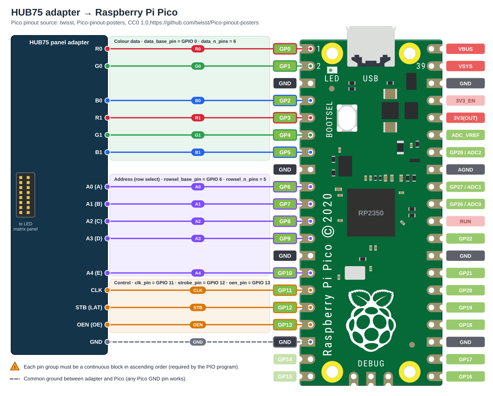
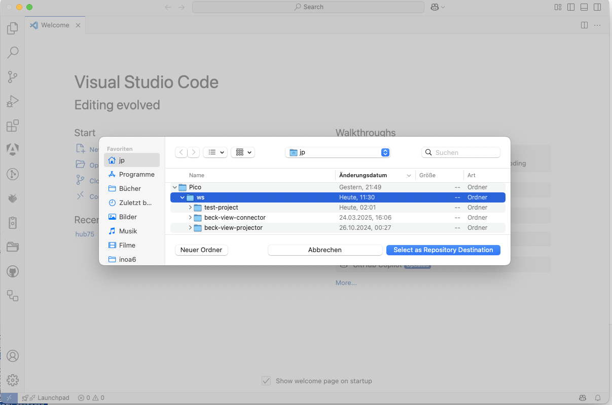
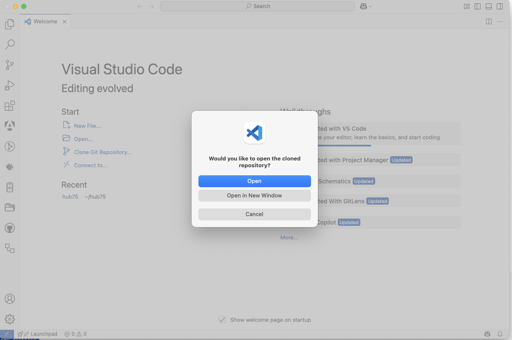
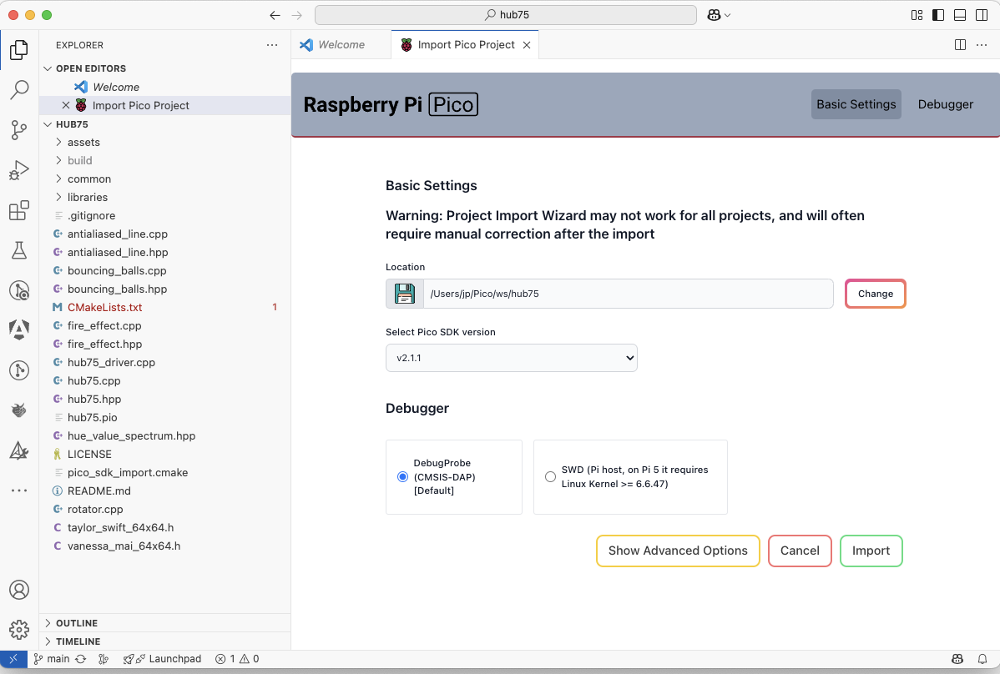
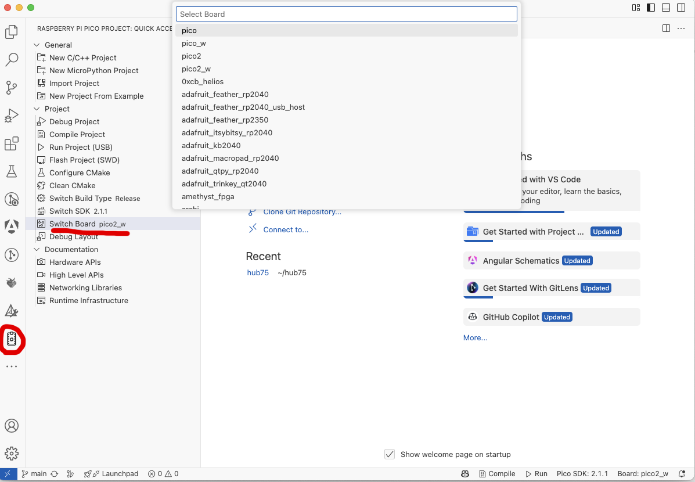
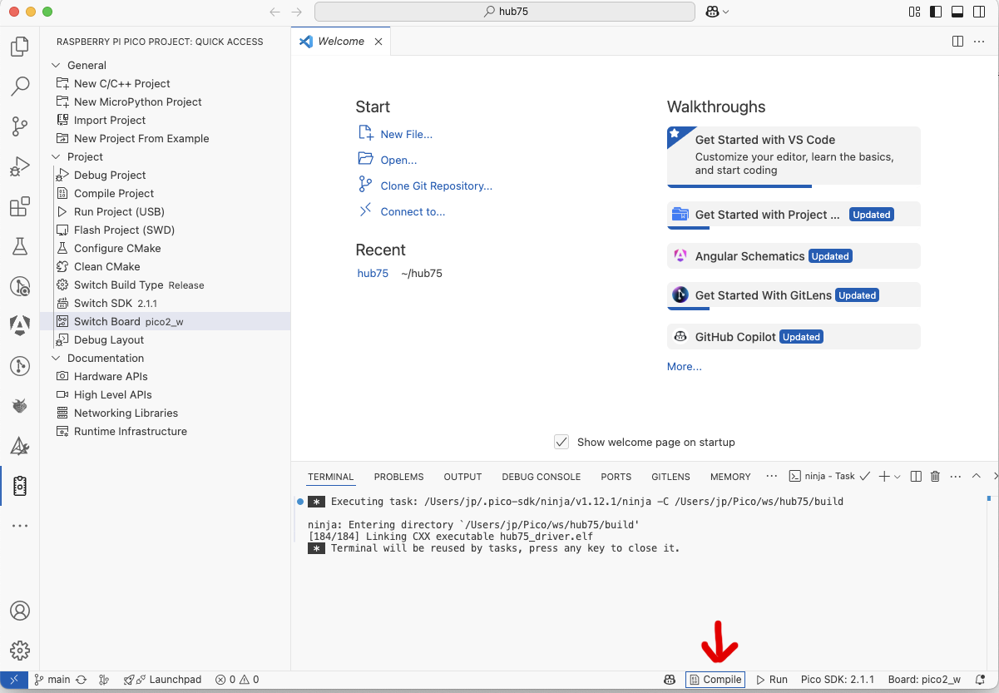

# HUB75 DMA/PIO Driver for Raspberry Pi Pico & Pico 2

**Let DMA and PIO drive your LED matrix – and keep your CPU for the application.**
Once started, the driver streams the panel autonomously; only hardware-triggered IRQ handlers run.

<https://github.com/user-attachments/assets/7c41193c-c724-4fae-8823-af36d70fcedd>

*Demo video: colours are much brighter and more brilliant in reality.*

## Why this driver?

- **Runs by itself.** DMA chains feed PIO state machines; no bit-banging, no timing loops on your core.
- **Colours that look right.** 10-bit binary code modulation with *balanced light output* (heavy bit-planes are split into slices, which cuts flicker), CIE1931 lightness correction, optional per-channel LUTs and a colour correction matrix.
- **Big and flexible.** Chain panels in serpentine (U-turn) layouts, rotate the display by 0/90/180/270°, or run two independent panels from one RP2350.
- **Configured in one place.** A single [`constexpr Hub75Config`](hub75_demo.cpp#14) is a template argument of [`Hub75Driver<Cfg>`](include/hub75.hpp#95): typos are compile errors, unused code is not built.
- **Many panel types.** From plain 64×64 panels to driver-IC specials, outdoor panels, shift-register panels and PWM panels (see below).

## What's new

### Shift-register row addressing (e.g. Waveshare Hub75 96×48 SM5368 v2)

Most panels take the row number as a binary address on pins A–E. Some panels instead advance the active row through a **shift register** (SM5368, 74HC595-type row switchers).

See [Settings for a Hub75 Panel with Shift Register for Row Addressing](#settings-for-a-hub75-panel-with-shift-register-for-row-addressing)

### ICND2153-based (S)PWM panels

PWM panels contain driver ICs (ICND2153) that **generate the grey levels themselves** from 16-bit values. The driver therefore does not produce bit-planes for these panels; it builds a 16-bit pixel stream, and the OE pin carries the grey-scale clock (GCLK). Wiring is identical to a standard panel.

See [Settings for a ICND2153 Based PWM Hub75 Panel](#settings-for-a-icnd2153-based-pwm-hub75-panel)

#### Video Sequence of ICND2153 Panel in Action

Here a brief sequence of the ICND2153 PWM panel in action (Taylor Swift image: By iHeartRadioCA, CC BY 3.0, https://commons.wikimedia.org/w/index.php?curid=137551448):

[ICND2153 PWM panel in action](https://github.com/user-attachments/assets/dfa43ba3-5b67-45b4-a143-8567f13d43ec)

*Demo video: colours are much brighter, more vivid and more brilliant in reality.*

## Where to go

- [Quick start](#quick-start) – get your first panel running

To explore the architectural details of the `Hub75 driver` see
- [Hub75 Matrix Panel Driver Version 3.0](docs/Hub75%20Matrix%20Panel%20Driver%20Version%203.0.md)
- [INCD2153 PWM Panel Details](./docs/icnd2153.md)

[Christoph](https://github.com/cmair) designed and implemented the refactoring of the driver code to allow multiple driver instances on a 
single Raspberry Pi Pico microcontroller. The result is a much more robust implementation where the compiler can check for configuration
mistakes and multiple (different) displays can operate independently off a single Pico as long as enough hardware resources are available.
- [Dual Panel Instances](docs/dual-instances.md) - show-case to run two independently-configured HUB75 chains from a single Pico

If you're interested in specific details — such as how to improve output quality or configure chained panels — the following links should help you explore the capabilities of the `Hub75 driver`
- [Configuration reference](docs/configuration.md) – reference for all attributes
- [Pixel mapping](docs/pixel-mapping.md) – choose the correct pixel mapping for your matrix panel
- [Colour pipeline](docs/colour.md) – balanced light output, CIE1931, colour correction matrix, brightness
- [Chained panels and rotation](docs/chaining-and-rotation.md) - topology of chained panels and software rotation of the displayed image
- [Supported, available and tested boards](docs/boards.md) - description and configuraton of supported and available panels
- [Troubleshooting](docs/troubleshooting.md)

# Quick Start

## Prerequisites

- **Hardware:** Raspberry Pi Pico or Pico W (RP2040), Pico 2 or Pico 2W (RP2350A/B) or compatible board
- **Panel:** HUB75-compatible LED matrix (64×64 default; other sizes configurable)
- **Host OS:** Linux, macOS, or Windows (WSL recommended on Windows)

## Wiring Details

### Default Mapping for HUB75 Connector → Raspberry Pico GPIOs

The diagram shows the default mapping as defined in the hub75.cpp file.
  


### Colour Data Pins

⚠️ It is a requirement of the `Hub75 driver` that the **colour pins** must be arranged in a continuous block in ascending order!

- `pins.data_base_pin` = **GPIO 0** (first in a consecutive block)
- `pins.data_n_pins` = **6** (for R0, G0, B0, R1, G1, B1)

| Hub75 Colour Bit   | connected to      | Pico GPIO |
|:-------------------|-------------------|:-----:|
| R0                 |                   | 0    |
| G0                 |                   | 1    |
| B0                 |                   | 2    |
| R1                 |                   | 3    |
| G1                 |                   | 4    |
| B1                 |                   | 5    |

### Address (Row Select) Pins

⚠️ It is a requirement of the `Hub75 driver` that the **address pins** must be arranged in a continuous block in ascending order!

- `pins.rowsel_base_pin` = **GPIO 6**
- `pins.rowsel_n_pins` = **5** (A0–A4)

| Address bit |  connected to      | Pico GPIO |
| ----------- |--------------------|:---------:|
| A0 (A)      |                    | 6    |
| A1 (B)      |                    | 7    |
| A2 (C)      |                    | 8    |
| A3 (D)      |                    | 9    |
| A4 (E)      |                    | 10   |

### Control Pins

⚠️ It is a requirement of the `Hub75 driver` that the **control pins** must be arranged in a continuous block in ascending order!

- **`pins.clk_pin`** (clock): GPIO 11
- **`pins.strobe_pin`** (latch): GPIO 12
- **`pins.oen_pin`** (output enable): GPIO 13


---

# Configuration in Code

## Overview

Almost all Hub75 driver configuration is done in your application program. See [hub75_demo.cpp](hub75_demo.cpp#14) as an example to follow the description below.

Values are passed as **template argument** to `Hub75Driver<Cfg>` :

```cpp
#include "hub75.hpp"

constexpr Hub75Config panel_cfg{
    .panel = { /* ... */ },
    .screen = { /* ... */ },
    .pins = { /* ... */ },
    .color = { /* ... */ },
    .frame_rate_debug = false,
};

using Panel = Hub75Driver<panel_cfg>;
static Panel driver; // large fixed-size buffers - must have static storage duration
```

This replaces the previous `target_compile_definitions`-based approach. 

The benefits:

- **Strictly type-checked at compile time** — a typo like `.data_base_pinn = 0` is a compile
  error, not a silently-ignored preprocessor define.
- **No more risk of a stale/forgotten `#ifndef` default** — every field has an explicit,
  visible default in `Hub75Config`'s member-initializers in `hub75.hpp`.
- **Multiple independent configurations in one program** are now possible — each
  `constexpr Hub75Config` instantiates its own `Hub75Driver<Cfg>` type, so you can run two
  differently-configured panels (even two different chains) from a single RP2350. See
  [Dual-Instance Configuration](#dual-instance-configuration).

If a field is **not set** in your `Hub75Config` initializer, it falls back to the **default
value** declared directly in the struct definition in `hub75.hpp` (see
[Notes on Default Values](#notes-on-default-values) below).

A **small number of build-system-level flags** remain in `CMakeLists.txt` — these control how
the project is *built*, not how the panel is *wired or timed*, so they stay as
`target_compile_definitions`: `PICO_RP2350A`, `USE_PICO_GRAPHICS`, and `HUB75_MULTICORE`.
See [Configuration in Code — Quick Reference](#configuration-in-code--quick-reference) for the
complete, current list.

## Configuration Examples  <a id='allowed_deviations_anchor'></a>

See [`hub75_demo.cpp`](hub75_demo.cpp#14) how to set the values of the [`Hub75Config`](include/hub75.hpp#95) structure to your needs.
Only a handful of build-system-level flags remain in [`CMakeLists.txt`](CMakeLists.txt).

### CMakeLists.txt Settings for Pico (RP2040) or Pico 2 (RP2430)

The following excerpt from file [`CMakeLists.txt`](CMakeLists.txt#26) shows that `pico2` is selected as the “Board type”. The `Hub75 driver` uses Pimoroni’s PicoGraphics library (`USE_PICO_GRAPICS`). The `Hub75 driver` runs on the second core `core1` of the `pico2`, while the first core (`core0`) is used by your application logic, which typically draws using Pimoroni’s graphics library.

Here is the default configuration in the [`CMakeLists.txt`](CMakeLists.txt) file that comes with this library.

```cmake

# ⚠️ look at or near line 26
set(PICO_BOARD pico2 CACHE STRING "Board type")  # depending on your pico hardware switch pico 2 (RP2430) to pico (RP2040)

# The following two lines must be uncommented to compile for bare RP2350 without a board
# set(PICO_PLATFORM rp2350)
# set(PICO_BOARD none CACHE STRING "Board type")

# ⚠️ look at or near line 78
target_compile_definitions(hub75_demo PRIVATE
    # PICO_RP2350A=0             # uncomment for RP2350B microcontrollers only
    USE_PICO_GRAPHICS=true       # set to false if you use hub75 as a library
    HUB75_MULTICORE=true         # use core1 for the hub75 driver
)
```

### Driver Configuration for Pico (RP2040) or Pico 2 (RP2430)
As mentioned earlier, the rest of your panel’s configuration is done in your application program. This is easier than it seems at first glance! The `Hub75 driver` has default values for all attributes. You only need to change an attribute if it does not match this default value. If you have a “standard” Hub75 matrix panel with 64 rows and 64 columns and have chosen to wire the pins as described earlier, you do not need to specify a single attribute, since the fallbacks in the `Hub75 driver` have already preset them accordingly. Your configuration therefore reduces to the minimal case listed here

```cpp
constexpr Hub75Config panel_cfg{};
```

If you have a "standard" 64x32 panel it is sufficient to set the configuration to

```cpp
constexpr Hub75Config panel_cfg{
    .panel = {
        .matrix_panel_width = 64,      // your matrix panel width - this line could be dropped as 64 columns is the hub75 drivers default
        .matrix_panel_height = 32,     // your matrix panel height - differs from the default value of 64
    },
};
```

as panel dimensions 64x64 (64 rows and 64 columns) is the default.

## Overview of Driver Configuration Attributes

To give you an overview of the available options let's show them all in brief (details in [Configuration in Code](#configuration-in-code)). Look at the start of `hub75_demo.cpp` to see how it is used. 
 
```cpp
// hub75_demo.cpp / your own .cpp file
constexpr Hub75Config panel_cfg{
    .panel = {
        .matrix_panel_width = 64,                  // your matrix panel width
        .matrix_panel_height = 64,                 // your matrix panel height
        .chain_rows = 1,                           // number of chain rows stacked vertically (rows)
        .chain_cols = 1,                           // number of panels chained left-to-right in a single chain row (columns)
        .panel_class = PanelClass::HUB75,          // standard HUB75 panel - another value is PWM
        .chain_mode = Hub75ChainMode::SERPENTINE,  // default is serpentine (U-Turn with compensation for 180° rotation)
        .panel_kind = RowMapping::Standard,        // how to map the rgb888 buffer onto the panel 
        .address_type = RowAddressing::Binary,     // row addressing via address pins
        .scan_mode = 0,                            // 0 tries to automatically deduce scan_mode else specify a value
        .panel_chip = Hub75PanelChip::GENERIC,     // mainly used for initialisation sequence but also for panel specific characteristics
        .pwm_reverse_chain_order = false,          // PWM panels only - reverse the order of the panels inside a chain
        .inverted_stb = false,                     // inverted pin signal for strobe (latch) pin
        .sm_clockdiv_factor = 1.0f,                // the driver is fast - to prevent flicker or ghosting it might be worth a try to reduce state machine speed
        .base_latch_ns = 180,                      // wait time in nano-seconds to stabilise latch
        .base_addr_ns = 260,                       // wait time in nano-seconds to stabilise row addressing
    },
    .screen = {
        .rotation = Hub75Rotation::DEG_0,          // display rotation (DEG_0, DEG_90, DEG_180 or DEG_270)
    },
    .pins = {
        .data_base_pin = 0,                        // base GPIO pin (aka start index) of R0, G0, B0, R1, G1, B1 GPIO pins
        .data_n_pins = 6,                          // number (count) of colour pins (usually 6: R0, G0, B0, R1, G1, B1)
        .rowsel_base_pin = 6,                      // base GPIO row select pin (aka start index) of A, B (, C, D. E) GPIO pins
        .rowsel_n_pins = 5,                        // row select pin count 
        .clk_pin = 11,                             // GPIO pin for CLK 
        .strobe_pin = 12,                          // GPIO pin for STROBE (LATCH)
        .oen_pin = 13,                             // GPIO for OE pin (GCKL for PWM panel class)
    },
    .color = {
        .bitplanes = 10,               // number (count) of bit-planes used for BCM (Binary Code Modulation) - valid values are 8, 10 for HUB75 panels and 16 for PWM panels
        .separate_cie_channels = true, // use separate CIE channels for improved colour representation - needs more memory
        .balanced_light_output = true, // improves image quality but needs some more memory
        .swap_rb_pins = false,         // swap red and blue pins in software
        .ccm_rg_shift = 6,             // CCM Cross-channel mixing - mix ~1.6% green into the red channel
        .ccm_gb_shift = 7,             // CCM Cross-channel mixing - mix ~0.8% blue into the green channel
    },
    .frame_rate_debug = false,         // for testing and debugging purpose only: output frame rate information (printf) e.g. in VS Code monitor - set to `false` for production
};
```

### CMakeLists.txt Settings for RP2350B

To use a `RP2350B` microcontroller adapt `CMakeLists.txt` as shown below.

```cmake
# ⚠️ look at or near line 26
# set(PICO_BOARD pico2 CACHE STRING "Board type")

# The following two lines must be uncommented to compile for bare RP2350 without a board
set(PICO_PLATFORM rp2350)
set(PICO_BOARD none CACHE STRING "Board type")

# ⚠️ look at or near line 78
target_compile_definitions(hub75_demo PRIVATE
    PICO_RP2350A=0               # uncomment for RP2350B microcontrollers only
    USE_PICO_GRAPHICS=true       # set to false if you use hub75 as a library
    HUB75_MULTICORE=true         # use core1 for the hub75 driver
)
```

### Driver Configuration for RP2350B

Since the `RP2350B` microcontroller has more pins available as the `pico2` in this example we use pins 30 up to pin 43 to connect to the matrix panel.

```cpp
constexpr Hub75Config panel_cfg{
    .panel = {
        .matrix_panel_width = 64,   // your matrix panel width
        .matrix_panel_height = 64,  // your matrix panel height
    },
    .pins = {
        .data_base_pin = 30,        // base GPIO pin (aka start index) of R0, G0, B0, R1, G1, B1 GPIO pins
        .data_n_pins = 6,           // number (count) of colour pins (usually 6: R0, G0, B0, R1, G1, B1)
        .rowsel_base_pin = 36,      // base GPIO row select pin (aka start index) of A, B (, C, D. E) GPIO pins
        .rowsel_n_pins = 5,         // row select pin count 
        .clk_pin = 41,              // GPIO pin for CLK 
        .strobe_pin = 42,           // GPIO pin for STROBE (LATCH)
        .oen_pin = 43,              // GPIO for OE pin (GCKL for PWM panel class)
    },
};
```

### Settings for a Hub75 Panel with Shift Register for Row Addressing

In standard HUB75 panels, the address pins (A, B, C, D, E) are usually used as binary address lines.
**Waveshares** matrix panel `Hub75 96x48 SM5368 Version 2`, for example, does not operate according to this scheme, but uses a shift register to advance to the next row.
This means that it does not output the address of the current row directly, but rather advances the row selection to the next row via a shift sequence.
This requires a dedicated row control logic. To advise the `Hub75 driver` to use this dedicated control logic set `.address_type = RowAddressing::ABCShiftRegister`.

We do not have any **Waveshare** panels at hand. User [Jason](https://github.com/jason-a69) was kind enough to carry out some basic testing of the `Hub75 96x48 SM5368 Version 2` panel. As [Jason](https://github.com/jason-a69) pointed out, he had to reduce the state machine (sm) clock `.sm_clockdiv_factor = 4.0f` to achieve a stable output. Currently testing and optimising of this panel is at rest due to missing hardware.

```cpp
constexpr Hub75Config panel_cfg{
    .panel = {
        .matrix_panel_width = 96,                  // your matrix panel width
        .matrix_panel_height = 48,                 // your matrix panel height
        .address_type = RowAddressing::ABCShiftRegister, // row addressing via shift register
        .scan_mode = 24,                           // 0: try to automatically deduce scan_mode - <value>: take value as scan_mode
        .sm_clockdiv_factor = 4.0f,                // the driver is fast - to prevent flicker or ghosting it might be worth a try to reduce state machine speed
     },
    .color = {
        .bitplanes = 10,                           // number (count) of bit-planes used for BCM (Binary Code Modulation)
        .balanced_light_output = true,             // improves image quality but needs some more memory
        .swap_rb_pins = true,                      // swap red and blue pins in software
    },
}
```
### Settings for a ICND2153 Based PWM Hub75 Panel

PWM modules generate the pulse width modulation themselves – in contrast, the BCM (Binary Coded Modulation), including the balanced light output, is generated by the `Hub75 driver` for Hub75 panels (`.panel_class = PanelClass::HUB75`). The `Hub75 driver` implementation for the ICND2153 PWM panel therefore is different. This is reflected in three configuration attributes `.panel_class = PanelClass::PWM`, `.panel_chip = Hub75PanelChip::ICND2153`. and `.bitplanes = 16`.

```cpp
constexpr Hub75Config panel_cfg{
    .panel = {
        .matrix_panel_width = 128,                 // your matrix panel width
        .matrix_panel_height = 64,                 // your matrix panel height
        .panel_class = PanelClass::PWM,            // it's a PWM panel
        .address_type = RowAddressing::Binary,     // row addressing via address pins
        .panel_chip = Hub75PanelChip::ICND2153,    // mainly used for initialisation sequence but also for panel specific characteristics
        .pwm_reverse_chain_order = false           // PWM panels only - reverse the order of the panels inside a chain
     },
    .color = {
        .bitplanes = 16,                           // number (count) of bit-planes for a ICND2153 PWM panel
        .separate_cie_channels = true,             // use separate CIE channels for improved colour representation - needs more memory
        .balanced_light_output = true,             // ⚠️ setting is ignored for PWM panels  
     },
    .frame_rate_debug = false,                     // for testing and debugging purpose only: output frame rate information (printf) e.g. in VS Code monitor - set to `false` for production
};
```

**Tested panel:** XR1.875-128x64-1515-32S-4L-V3.0 (128×64, 1/32 scan).

**Memory:** this configuration needs ample memory – a Pico (RP2040) might do but plan for an Pico 2 (RP2350). Chaining of two such panels should work for Pico 2 but is not verified.

If the panels of a chain appear in the wrong order, set `.pwm_reverse_chain_order = true`.

Details on the implementation of this PWM panel driver can be found in [INCD2153 explained](./docs/icnd2153.md).

 
## How to Use This Project in VSCode

You can easily use this project with VSCode, especially with the **Raspberry Pi Pico plugin** installed. Follow these steps:

1. **Open VSCode and start a new window**.
2. **Clone the repository**:
   - Press `Ctrl+Shift+P` and select `Git: Clone`.
   - Paste the URL: `https://github.com/JuPfu/hub75`

      

   - Choose a local directory to clone the repository into.

      

3. **Project Import Prompt**:
   - Consent to open the project.

      

   - When prompted, "Do you want to import this project as Raspberry Pi Pico project?", click **Yes** or wait a few seconds until the dialog prompt disappears by itself.

4. **Configure Pico SDK Settings**:
   - A settings page will open automatically.
   - Use the default settings unless you have a specific setup.

      

   - Click **Import** to finalize project setup.
   - Switch the board-type to your Pico model.

      

5. **Wait for Setup Completion**:
   - VSCode will download required tools, the Pico SDK, and any plugins.

6. **Connect the Hardware**:
   - Make sure the HUB75 LED matrix is properly connected to the Raspberry Pi Pico.
   - Attach the Rasberry Pi Pico USB cable to your computer

7. **Build and Upload**:
   - Compiling the project can be done without a Pico attached to the computer.

      

   - Click the **Run** button in the bottom taskbar.
   - VSCode will compile and upload the firmware to your Pico board.

> 💡 If everything is set up correctly, your matrix should come to life

---

## Demo Effects

The demo effects in `hub75_demo.cpp` are included to exercise the driver and showcase colour fidelity. They eefects cycle automatically.

| # | Effect | Purpose |
|---|--------|---------|
| 0 | Bouncing balls with text | Tests real-time animation; text position is hard-coded for 64×64 |
| 1 | Fire effect | Demonstrates per-pixel colour blending at high refresh rates |
| 2 | Static 64×64 images | Verify colour accuracy and panel mapping on the reference panel size |
| 3 | Rotator | Geometric transformation test - rotating antialiased line |
| 4 | Analog clock | Geometric transformation test - application of multiple rotating antialiased lines|
| 5 | Colour gradient / plasma | Full-spectrum colour coverage |
| 6 | Straight lines | Helps to detect mapping errors |
| 7 | Grey-scale ramp | **Calibration tool** — equal R, G, B at every luminance step. Use this with the [CCM Tuning Procedure](docs/colour.md#tuning-procedure) to eliminate colour tints |

> ⚠️ The demo has been tested on a **Raspberry Pi Pico 2 RP2350A** and **Raspberry Pi Pico 2 RP2350B**. On a RP2040 you may need to comment out some effects due to tighter memory constraints. Open an issue if you need help.

## Next Steps

The core driver pipeline is stable. Possible future directions include:

- **Additional matrix panel support** — Implement support for additional PWM matrix panels or not yet supported matrix panel driver chips.
- **RP2040 memory optimisations** — the `color.separate_cie_channels`, `color.balanced_light_output`, and `color.bitplanes` fields already allow memory/quality trade-offs; further tuning for constrained targets is an open area.

For questions, bug reports, or feature discussions, feel free to open an issue on [GitHub](https://github.com/JuPfu/hub75).

---

