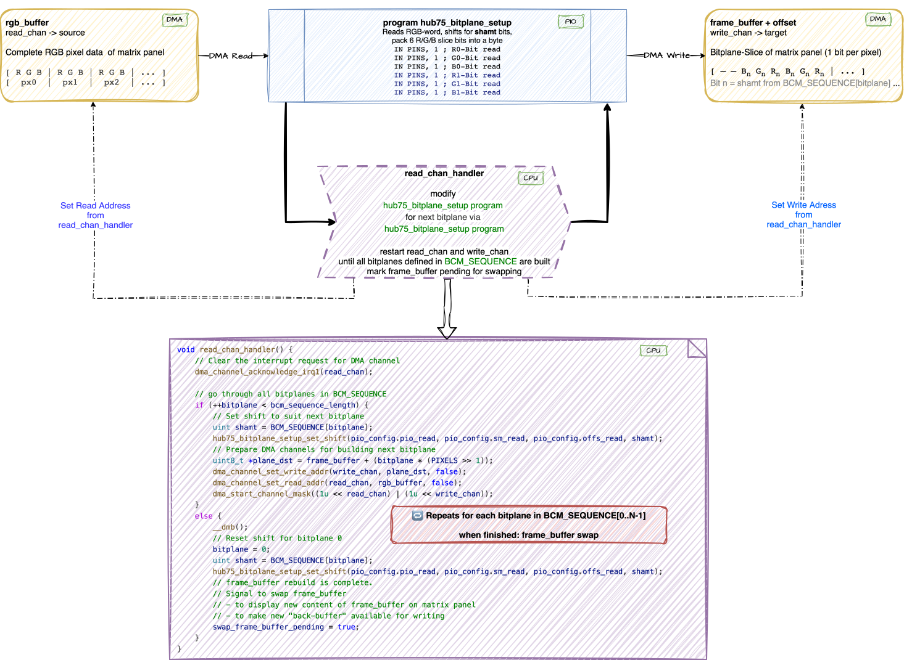

# HUB75 DMA-Based Driver

## Hub75 Matrix Panel Driver Version 3.0

Version 3.0 is a near-complete rework of the DMA/PIO pipeline. Once started, the driver runs almost entirely in hardware — the CPU is barely involved. Two independent DMA/PIO stages handle all the work: one constructs BCM bitplanes on demand whenever `update()` or `update_bgr()` is called; the other streams the pre-built bitplanes to the panel autonomously and continuously. For the full architectural detail see [The Definitive Hub75 Driver Solution](#the-definitive-hub75-driver-solution--a-bitplane-stream-with-parallel-reading-and-display-of-pixel-data).

## Achievements at a Glance

A detailed description of the development history, the motivation and some external documentation links nad reference can be found in [HUB75 Driver — Development History](../docs/HISTORY.md).

### Version 2.0 — DMA/PIO Pipeline

Improvements:

- **CPU Offloading** — Processing moved from the CPU to DMA and PIO co-processors.
- **Self-paced Pipeline** — Interlinked DMA and PIO processes run without CPU supervision.
- **No Blocking Synchronization** — `hub75_wait_tx_stall` eliminated entirely.
- **Reduced Interrupt Complexity** — Lighter, leaner interrupt handlers.

### Version 3.0 — Colour Fidelity & Signal Integrity

Building on the DMA/PIO foundation, Version 3.0 adds:

- **On-demand Bitplane Construction** — RGB pixel data is decomposed into BCM bitplanes
  by a dedicated DMA/PIO stage, triggered only on `update()` / `update_bgr()`.
  Streaming to the panel runs fully autonomously in the background.
- **Balanced Light Output** — High-weight bitplanes are split into multiple shorter segments,
  spreading illumination evenly across the frame. Effective refresh rate increases significantly;
  visible flicker is eliminated even at low brightness.
- **Per-channel CIE 1931 Correction** — Separate `CIE_RED`, `CIE_GREEN`, `CIE_BLUE` lookup
  tables (generated by `cie.py`) map 8-bit input to 10-bit perceptually linear output,
  with per-channel white-balance scaling via `RED_CAP` / `GREEN_CAP` / `BLUE_CAP`.
- **Colour Correction Matrix (CCM)** — Six integer-shift cross-terms correct spectral bleed
  between channels. Zero floating-point cost; off by default (`shift = 31`).
- **Anti-ghosting & Settling Delays** — Configurable nano-second timing guards
  (`BASE_LATCH_NS`, `BASE_ADDR_NS`) around latch and address transitions
  eliminate ghosting and edge glimmer at high clock speeds.
- **Double-buffering for both frame and command buffers** — Tear-free updates; the
  `row_cmd_buffer` is only swapped when brightness actually changes.
- **`cie.py` generates the full `cie.hpp`** — The LUT generator now emits the complete
  header file including all `#if SEPARATE_CIE_CHANNELS` / `#if BITPLANES` preprocessor
  guards. Run once, redirect to file, done:
```bash
  python3 utils/cie.py > cie.hpp
```

Together these enhancements deliver a display pipeline that is faster, more visually accurate, and almost entirely autonomous — leaving the CPU free for application logic.

---


## The Definitive Hub75 Driver Solution – A Bitplane Stream with Parallel Reading and Display of Pixel Data

A detailed desciption of the evolution of the Hub75 driver can be found here: [Evolution of the Hub75 driver](../docs/History.md)

### Overview of the Redesigned Alternative Approach

A (nearly) complete rework of the DMA/PIO pipeline has been done. In this context, I removed some features, such as temporal dithering, and added new ones, such as **Balanced Light Output** and did implement **[board707´s](https://github.com/board707)** suggestion of parallel loading of data while BCM is running.

In addition to **[Pimoroni’s anti-ghosting](https://github.com/pimoroni/pimoroni-pico/commit/9e7c2640d426f7b97ca2d5e9161d3f0a00f21abf)**, a “cooling-off period” for the line decoder has been incorporated after the address is set. Precise timing values in nano-seconds can be specified via compile time definitions in CMakeLists.txt. This applies to the the wait time to stabilise latch, the wait time to stabilise row addressing, and pre-Oe guard wait time to prevent ghost flashes. The matrix panels available to me show no ghosting, no flickering, and no glimmering of pixels at the edges of the matrix even in dark environments.

The output quality has improved due to the usage of Balanced Light Output. That is, bit planes with high weight are divided into several smaller segments within the BCM sequence. This increases the effective refresh rate and reduces flickering.

An interrupt handler is used to support the conversion of rgb pixel data into bitplane slices. At the end of the update() and update_bgr() methods the bitplane slices are constructed heavily relying on DMA and PIO support. This is in stark contrast to the previous version where this had been done on the fly for every frame. The result is a stream of bitplane slices pushed to the matrix panel in a highly efficient manner.

Another interrupt handler is called once per frame. This interrupt handler is responsible for double-buffer administration (pointer switching) of the frame_buffer and double-buffering of the row_cmd_buffer. Both buffers are switched only when necessary. The row_cmd_buffer only when a brightness change has been made, and the frame_buffer when update or update_bgr is called.

### High-Level Architectural View of HUB75 Pipeline

```
CPU part - usually done in 60Hz or 100Hz frequency

[Input 8-bit RGB via update(...) or update_bgr(...) method]
        ↓
[Double Buffered Frame Buffer]
        ↓
[CIE → 10-bit or 8-bit linear light]
        ↓
[Color Correction Matrix (per channel)]
        ↓
[Pixel Mapping / Layout Transform]
        ↓
DMA & PIO part - usually runs at much higher frequency than the CPU part

[Bitplane Extraction Engine (DMA- and PIO-based with a bitplane sequence optimised for the balanced light output strategy)]
        ↓
[DMA → PIO Row Engine (OE / LAT / ADDR)] ← → [DMA → PIO Engine for bitplane row streaming]
        ↓
[Matrix Panel]
```

The driver has transitioned from a CPU-intensive real-time mapping approach to a structured, three-stage hardware pipeline. This change significantly reduces CPU overhead.

### 1. Canonical Mapping Stage (`update()` / `update_bgr()`)
* **Panel-Specific Normalization:** All panel-specific quirks (scan-mode, physical row mapping, and ZigZag patterns) are handled during the initial copy to `rgb_buffer`.
* **Standardized Format:** The buffer is organized into a "canonical" 32-bit RGB format, allowing the subsequent PIO stages to remain generic and extremely fast.

### 2. The New Hardware Pipeline
The data flow is now managed by three specialized PIO programs working in concert:

| Component | Role | Mechanism |
| :--- | :--- | :--- |
| **`hub75_bitplane_setup`** | **Bit-Slicing** | Converts the canonical `rgb_buffer` into the bit-plane structured `frame_buffer`. |
| **`hub75_bitplane_stream`** | **Data Feeding** | Streams the prepared bit-planes to the panel's shift registers. |
| **`hub75_row`** | **Timing & Logic** | The "Master" State-Machine (SM). Handles Row Addressing (A-E), BCM timing, and Latch (STB) signals. |

### 3. Simplified DMA Structure
The DMA logic has been streamlined. Instead of complex per-row interrupts, the system now uses **DMA Chaining**:
* **Autonomous Frames:** DMA channels now loop through all bit-planes and rows automatically.
* **Minimal CPU Interrupts:** The Interrupt Handler is now only called **once per frame**. 
  
  It handles:
    1. **Double-Buffering:** Swapping `frame_buffer` and `row_cmd_buffer` only when a full frame is complete.
    2. **Runtime Updates:** Activating new BCM cycles if brightness was changed via the API.

### 4. Advanced Signal Integrity & Anti-Ghosting
The `hub75_row` program now includes specific hardware-level timing improvements:
* **Anti-Ghosting Wait Cycles:** A configurable `wait_loop` is executed after the Latch (STB) signal but before enabling the next row. This ensures the LEDs from the previous row have fully discharged, eliminating the "shadow" or "ghost" effect common in high-speed multiplexing.
* **Settling Buffers:** Added precise timing padding around the Address (A-E) and Strobe transitions to account for cable capacitance and level-shifter propagation delays.
* **Hardware Synchronization:** `hub75_row` and `hub75_bitplane_stream` are hardware-locked via PIO IRQ flags, ensuring that row switching never occurs while data is still being shifted.

### 5. Efficient BCM with Split-Bitplanes
* **Balanced Light Output:** High-weight bit-planes are split into multiple smaller slices within the BCM sequence. This increases the effective refresh rate and eliminates visible flicker, even at low intensity settings.
* **Constant Frame Rate:** The sum of `lit_cycles` and `dark_cycles` is kept constant, ensuring a rock-solid refresh rate regardless of brightness levels.

### Step-by-Step Breakdown of DMA and PIO Cooperation

Two independent DMA/PIO pipelines do the "background" work in the **Definitive Hub75 Driver Solution**.

The first DMA/PIO pipeline transforms the RGB pixel data into bitplane slices. This is done <em>On Demand</em> whenever the <code>update(...)</code> or <code>update_bgr(...)</code> method is called by the user.

The second DMA/PIO pipeline streams the bitplanes to the matrix panel.  Each row in the bitplane has its address and on/off BCM duration supplied from a precalculated structure which is read via DMA. Loading of pixel data (bitplanes) and BCM are done in parallel.

#### RGB Pixel Data Transformation into Bitplane Slices



*Picture 4: Bitplane Creation Pipeline*

#### Row-Addressing, Loading and Display of Pixel Data


*Picture 5: Row-Addressing, Pixel Loading and BCM*

### Refresh Rate Performance

With a **bit-depth of 10** or a **bit-depth of 8**, the HUB75 driver achieves the following refresh rates for a 64 x 64 standard Hub75 matrix panel with scan mode 2 depending on the system clock and basis brightness settings.

Here some more relevant settings if you want to repeat the measurements and verify the listed frame rates:

```cpp
constexpr Hub75Config panel_cfg{
    .panel = {
        .sm_clockdiv_factor = 1.0f,     // to prevent flicker or ghosting it might be worth a try to reduce state machine speed
    },
    .color = {
        .bitplanes = 10,                // number of bit-planes used for Binary Code Modulation - valid values are 8 or 10
        .balanced_light_output = true,  // uses some more memory but it improves effective refresh rate and really cuts down flicker
        .separate_cie_channels = true,  // use separate CIE channels for improved colour representation - needs more memory
    },
    .frame_rate_debug = true,           // emit frame rate information on usb - disable for production usage
};
```
`HUB75_MULTICORE=true` remains a `CMakeLists.txt` build flag — see
[Remaining `CMakeLists.txt` Build Flags](#remaining-cmakeliststxt-build-flags).


| System Clock | Basis Brightness | Refresh Rate for 10 Bitplanes |  Refresh Rate for 8 Bitplanes |
|--------------|------------------|-------------------------------|-------------------------------|
| 100 MHz      | 8                | ~271 Hz                       | ~519 Hz                       |
| 150 MHz      | 8                | ~398 Hz                       | ~762 Hz                       |
| 200 MHz      | 8                | ~519 Hz                       | ~993 Hz                       |
| 250 MHz      | 8                | ~634 Hz                       | ~1216 Hz                      |
| 266 MHz      | 1                | ~1009 Hz                      | ~1285 Hz                      |
| 266 MHz      | 2                | ~1009 Hz                      | ~1285 Hz                      |
| 266 MHz      | 4                | ~951 Hz                       | ~1285 Hz                      |
| 266 MHz      | 8                | ~670 Hz                       | ~1285 Hz                      |
| 266 MHz      | 16               | ~412 Hz                       | ~1121 Hz                      |
| 266 MHz      | 32               | ~230 Hz                       | ~751 Hz                       |
| 266 MHz      | 64               | ~121 Hz                       | ~441 Hz                       |
| 266 MHz      | 128              | ~62 Hz                        | ~239 Hz                       |
| 266 MHz      | 255              | ~31 Hz                        | ~124 Hz                       |


These results demonstrate stable operation and high-performance display rendering across a wide range of system clocks.

Overall, performance has improved compared to the predecessor versions. In summary, the following factors are responsible for this:

- pixel data are provided in a bitplane structure and only need to be streamed to the matrix panel
- loading of pixel data (bitplanes) and Binary Coded Modulation (BCM) are done in parallel as proposed by **[board707](https://github.com/board707)**

The performance improvements mainly affect the lower and middle brightness ranges. Starting at a “Base Brightness” of 64 and higher, the BCM component becomes dominant. At that point, even the parallel loading of the pixel data and its provision in a bit-plane structure no longer provides any (significant) speedup.

The revised driver requires slightly more memory resources to achieve the improved quality. I am using “defines” to disable certain (new) functionalities and thus make more memory available for applications.

### Key Benefits of this Approach

✅ Fully **automated** data transfer using **chained DMA channels**.

✅ Eliminates **CPU-intensive** busy-waiting (`hub75_wait_tx_stall`).

✅ Ensures **precise timing** without unnecessary stalling.

---

## Conclusion for DMA and PIO based Approach

By offloading tasks to **DMA and PIO** the definitive HUB75 driver achieves **higher performance**, **simpler interrupt handling**, and **better synchronization**. Especially splitting RGB data into bitplanes **on demand** in a separate **DMA and PIO** step has contributed a great deal to this improvement. This separate step also eased the implementation of **Balanced Light Output**. Overall, this approach has significantly reduced CPU overhead while simultaneously minimizing artifacts such as **ghosting** at high clock speeds.

If you're interested in optimizing **RGB matrix panel drivers**, this implementation serves as a valuable reference for efficient DMA-based rendering.
