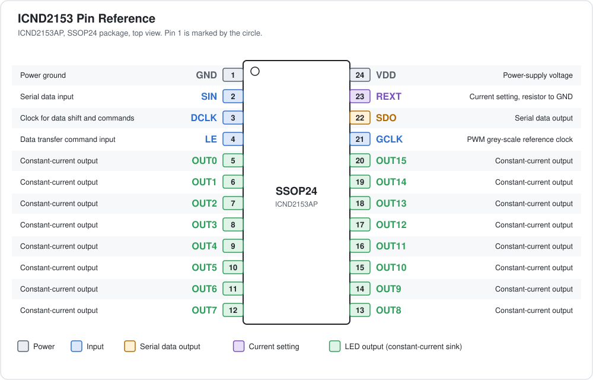
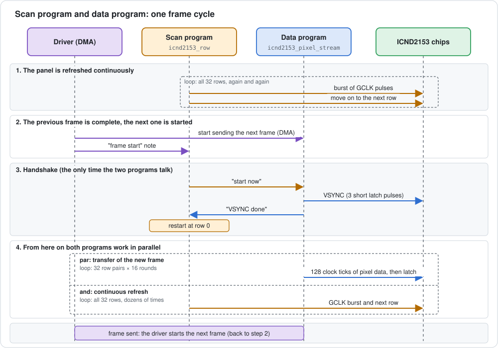
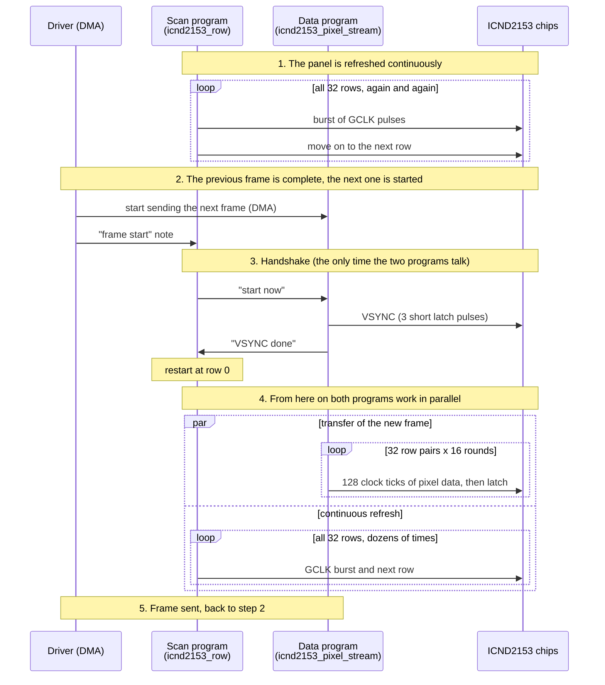

# Prologue

I bought the XR1.875-128x64-1515-32S-4L-V3.0 panel around the beginning of February 2026. At the time, I had no way of knowing what I was getting myself into by integrating a driver for this panel into the Hub75 project. Over the course of the year, I made several attempts to get this panel working.  I had very little information about this very panel and no knowledge of how PWM matrix panels work. Over the summer, I came across the image below, showing the oscilloscope readings and register descriptions by [wata-net](https://github.com/wata-net) in [issue#466](https://github.com/hzeller/rpi-rgb-led-matrix/issues/466) of the [rpi-rgb-led-matrix](https://github.com/hzeller/rpi-rgb-led-matrix) project. Together with the article at [The cuckoo's nest](https://kuku.eu.org/?projects/hub75e/index), that was the (knowledge) breakthrough.


*FIGURE 1: Oscilloscope Measurements, Table of Commands, and Register Map*

# ICND2153: How Pixel Data Reaches the Panel

The following description refers to a 128×64 ICND2153 PWM matrix panel. After reading it you will know what an *output channel* and a *lane* are, and in which order pixel data is sent to the panel.

## The Building Blocks

### The ICND2153 chip and its output channels

An ICND2153 chip drives **16 LEDs of the same colour**. Which colour that is depends on how the chip is wired on the panel board: some chips drive only red LEDs, some only green and some only blue. Each LED is connected to one of the chip's 16 **output channels**, named `OUT15` down to `OUT0`.

Every output channel stores its own **16-bit brightness value** for its LED, and the chip generates the PWM signal for that LED on its own. The PWM is synchronised by the GCLK signal, which is wired to the panel's OE pin.

All 16 output channels of a chip belong to the same colour, but each one holds the brightness of a *different pixel*. A chip therefore serves 16 neighbouring pixels in a single colour. The other two colours of these 16 pixels are handled by two further chips (see below).

**Terminology:** In this document,

a)  *output channel* always means one of the 16 outputs of an ICND2153 chip. 

b) the red, green and blue parts of a pixel are called *colour components*.



### Lanes

A colour pixel needs three chips: one for red, one for green and one for blue. The HUB75 connector offers six data pins, three for the colours of the primary row and three for the colours of the paired row:

| Data pin | Colour | Row |
| -------- | ------ | --- |
| R1 | red | primary row |
| G1 | green | primary row |
| B1 | blue | primary row |
| R2 | red | paired row |
| G2 | green | paired row |
| B2 | blue | paired row |

Behind each data pin sits a chain of ICND2153 chips. This chain, together with its data pin, is called a **lane**. The panel therefore has **6 lanes**, and every lane has the same number of chips. Each data pin transfers **1 bit per clock tick**, so all six lanes receive one bit at the same time.


*FIGURE 2: HUB75 connector -> 6 lanes -> 8 ICND2153 chips per lane -> 16 output channels per chip*

### Why two rows at once?

The 128×64 panel is driven in 1/32 scan mode. That means two rows are active at the same time: row *r* of the upper half (the **primary row**) and row *r + 32* of the lower half (the **paired row**). Together they form a **row pair**.

## Storage Calculation

- 16 output channels per chip means 16 pixels per chip and colour.
- 128 columns need 128 / 16 = **8 chips per lane**.
- 6 lanes with 8 chips each give **48 chips**, which matches the number of ICND2153 chips on the panel board.

| | red | green | blue |
| --- | --- | --- | --- |
| primary row | 8 chips | 8 chips | 8 chips |
| paired row | 8 chips | 8 chips | 8 chips |

**Conclusion:** Each chip has 16 output channels, so one scan line needs 16 × 16 bits = 256 bits per chip. The panel is scanned with 32 lines, and the driver sends all 32 lines of a frame to the chips before the next frame starts. The chips therefore keep the values of all 32 scan lines in their built-in memory (16 channels × 16 bits × 32 lines = 8,192 bits per chip) and step through the lines themselves.

## From 8-bit Colour to 16-bit Brightness

The graphics library draws with 8 bits per colour component (R8, G8, B8). The PWM chips expect 16 bits per component. The driver therefore converts every component with a lookup table (CIE 1931 gamma correction) to a 16-bit value.

## How the Pixels Are Sent

### The key idea

The 16 pixels that belong to one chip are **not** sent one after the other. Instead, the data is sent in **16 rounds**. In every round each chip receives the value for **one** of its output channels.

- **Round 1** serves `OUT15` of every chip. In the first lane that is pixel 0, pixel 16, pixel 32, and so on up to pixel 112.
- **Round 2** serves `OUT14` of every chip. That is pixel 1, pixel 17, pixel 33, and so on.
- ...
- **Round 16** serves `OUT0` of every chip. That is pixel 15, pixel 31, pixel 47, and so on up to pixel 127.


*FIGURE 3: interleaving - which pixel goes to which chip and output channel in rounds 1, 2 and 16*

### What happens inside one round

Within a round the 8 chips of a lane are served one after the other. For each chip the 16 bits of its value are sent, MSB first (bit 15 down to bit 0). All six lanes are served in parallel, so each clock tick carries 6 bits:

| Lane | Bit sent with each clock tick |
| ---- | ----------------------------- |
| R1, G1, B1 | one bit of red, green and blue of the pixel in the **primary row** |
| R2, G2, B2 | one bit of red, green and blue of the pixel in the **paired row** |

Sixteen such clock ticks transfer one complete pixel of the primary row and one complete pixel of the paired row, each with 16 bits per colour component:


*FIGURE 4: one clock tick = 6 bits on 6 data pins; 16 ticks = 2 pixels*

### The complete procedure

```text
for each row pair (row r and row r + 32):

    for each round (OUT15 down to OUT0):          # 16 rounds

        for each chip position in the lanes:       # 8 chips per lane
            pixel = chip position * 16 + round index
            send the 16 bits of this pixel, MSB first, 6 bits per clock tick
            (R, G, B of the primary row and R, G, B of the paired row)

        the chips takes over the data of this round
```

### In numbers

| | Clock ticks |
| --- | --- |
| one chip (16 bits) | 16 |
| one round (8 chips) | 8 × 16 = 128 |
| one row pair (16 rounds) | 16 × 128 = 2,048 |
| one frame (32 row pairs) | 32 × 2,048 = 65,536 |

Each clock tick carries 6 bits, one per lane. A whole 128×64 frame thus consists of 65,536 clock ticks.


*FIGURE 5: overview - one row pair is 16 rounds x 128 clock ticks*


# Keeping the Panel Lit While New Data Arrives

Two small programs run on the Pico's PIO hardware and do the actual work of talking to the panel, without involving the CPU. Their interplay is what makes the picture stable and flicker-free:

| Program | Think of it as | Job |
| ------- | -------------- | --- |
| `icnd2153_pixel_stream` | the **data program** | Delivers the pixel data to the chips: it sets the six data pins, produces the clock ticks (DCLK) and the latch pulses (LE). |
| `icnd2153_row` | the **scan program** | Keeps the panel refreshing: it produces the GCLK pulses on the OE pin and moves the panel from row to row. |

## What the panel needs

1. **Pixel data.** The chips need the 16-bit values of a whole frame. Sending them takes 65,536 clock ticks (see the numbers above).
2. **A refresh that never stops.** Each chip generates the PWM for its LEDs from the GCLK signal, and the rows have to be switched on one after the other. If GCLK or the row switching stopped while data is being sent, the picture would flicker or go dark.
3. **A common starting point.** The chips and the row switching must agree where a frame begins: with row 0. A short signal called **VSYNC** tells the chips "a new frame starts now".

One program cannot do requirements 1 and 2 at the same time, because both need exact timing at all moments. That is why there are two programs, and each one only does its own job.

## One frame cycle





*FIGURE 6: the scan program never stops. The data program is started once per frame.*

### Step by step

1. **The panel keeps refreshing.** The scan program walks through the 32 rows again and again. For each row it sends a fixed burst of GCLK pulses (138 in the current driver) and then signals the panel to move on to the next row. The chips light the LEDs with the values they have stored.
2. **The next frame is started.** When the data program has finished sending a frame, the driver (a DMA interrupt) starts the transfer of the next frame. This is the newest picture if the application has delivered one, otherwise the same picture again. At the same moment it drops a "frame start" note for the scan program.
3. **The handshake.** The scan program finds the note when it has finished its current pass over all rows. It tells the data program "start now". The data program sends the VSYNC signal to the chips (three short latch pulses) and answers "VSYNC done". The scan program then starts again at row 0. Now chips and row switching agree on where the frame begins.
4. **Both work in parallel.** The data program sends the whole frame to the chips. This takes much longer than one pass over the 32 rows, so in the meantime the scan program refreshes the panel dozens of times. Neither program waits for the other.
5. **Frame complete.** When the last pixel is delivered, the cycle starts again at step 2.

The two programs only exchange two short messages per frame, "start now" and "VSYNC done". In between, they do not need to know anything about each other.

## What runs in parallel

At any moment, three things happen at the same time:

| What | Who does it |
| ---- | ----------- |
| The current picture is **shown** on the panel. | Chips (PWM from GCLK) and the scan program. |
| The next picture is **transferred** to the chips. | DMA and the data program, without the CPU. |
| The picture after that is **prepared**. | The CPU converts the application's pixels into the data stream (see "How the Pixels Are Sent") and places it in a second buffer. The buffers are swapped at the frame boundary. |

## How the requirements are met

| Requirement | Solution |
| ----------- | -------- |
| Deliver a whole frame of 16-bit pixel data | The data program, fed by DMA, sends 65,536 clock ticks per frame. |
| Never interrupt the refresh | The scan program runs on its own and keeps the GCLK pulses and the row switching going while data is being sent. |
| Chips and rows must start together | The handshake at the start of every frame: VSYNC for the chips, row 0 for the scan program. |
| Do not disturb the CPU | Both programs and the DMA work without the CPU. It only prepares the next picture. |


