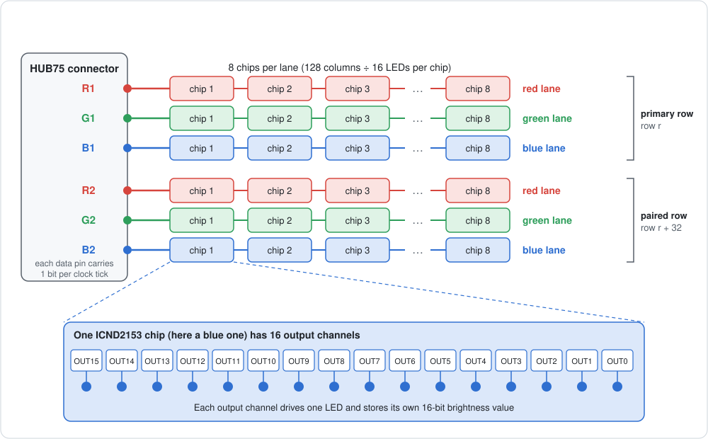
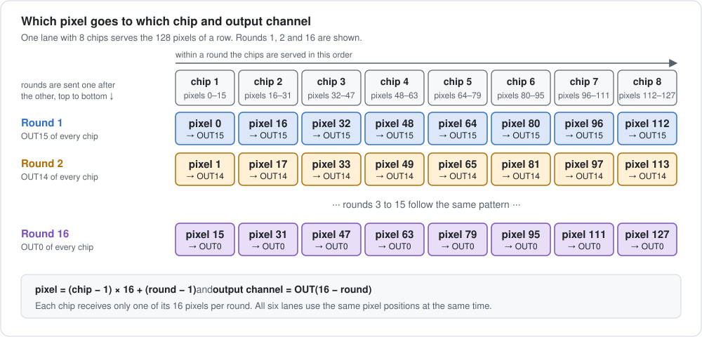
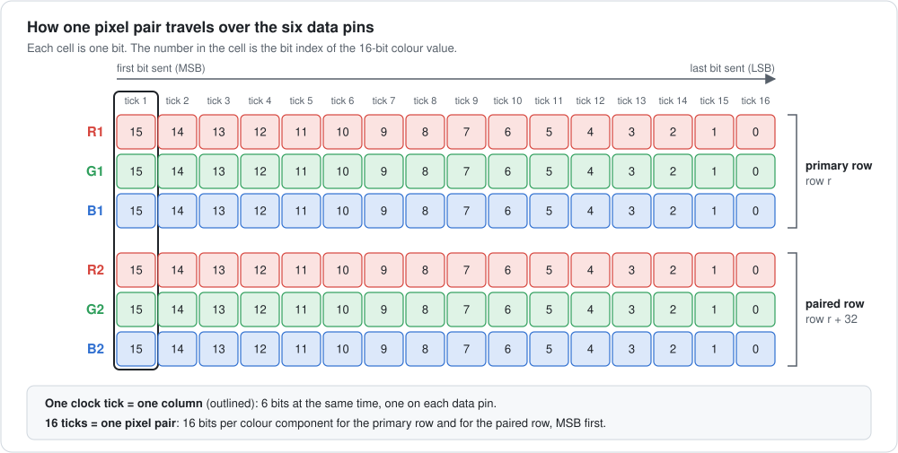
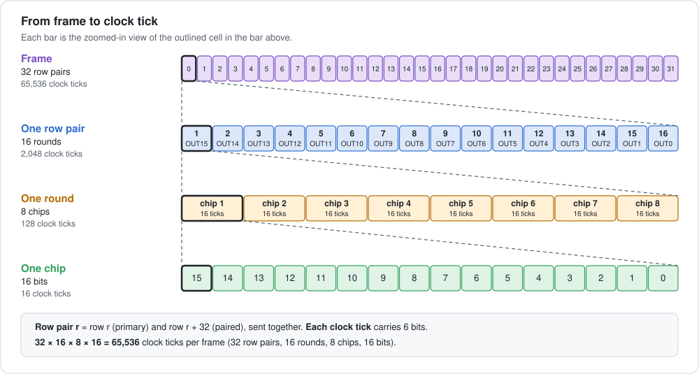
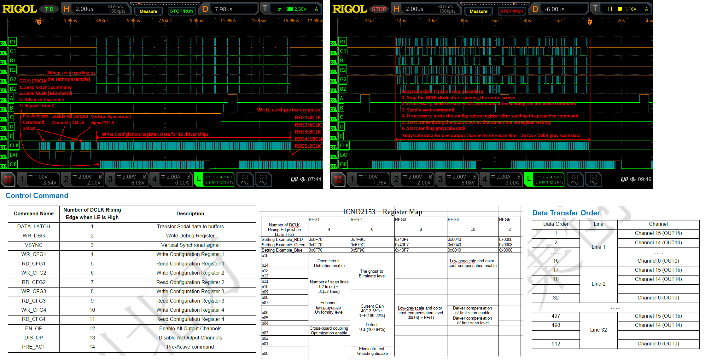

# ICND2153: How Pixel Data Reaches the Panel

The following description refers to a 128×64 ICND2153 PWM matrix panel. After reading it you will know what an *output channel* and a *lane* are, and in which order pixel data is sent to the panel.

## The Building Blocks

### The ICND2153 chip and its output channels

An ICND2153 chip drives **16 LEDs of the same colour**. Which colour that is depends on how the chip is wired on the panel board: some chips drive only red LEDs, some only green and some only blue. Each LED is connected to one of the chip's 16 **output channels**, named `OUT15` down to `OUT0`.

Every output channel stores its own **16-bit brightness value** for its LED, and the chip generates the PWM signal for that LED on its own. The PWM is synchronised by the GCLK signal, which is wired to the panel's OE pin.

All 16 output channels of a chip belong to the same colour, but each one holds the brightness of a *different pixel*. A chip therefore serves 16 neighbouring pixels in a single colour. The other two colours of these 16 pixels are handled by two further chips (see below).

**Terminology:** In this document, *output channel* always means one of the 16 outputs of an ICND2153 chip. The red, green and blue parts of a pixel are called *colour components*.

### Lanes

A colour pixel needs three chips: one for red, one for green and one for blue. The HUB75 connector offers six data pins, three for the colours of the primary row and three for the colours of the paired row:

| Data pin | Colour | Row |
| -------- | ------ | --- |
| R1 | red | primary row |
| G1 | green | primary row |
| B1 | blue | primary row |
| R2 | red | paired row |
| G2 | green | paired row |
| B2 | blue | paired row |

Behind each data pin sits a chain of ICND2153 chips. This chain, together with its data pin, is called a **lane**. The panel therefore has **6 lanes**, and every lane has the same number of chips. Each data pin transfers **1 bit per clock tick**, so all six lanes receive one bit at the same time.


<!-- FIGURE 1: HUB75 connector -> 6 lanes -> chips -> 16 output channels per chip -->

### Why two rows at once?

The 128×64 panel is driven in 1/32 scan mode. That means two rows are active at the same time: row *r* of the upper half (the **primary row**) and row *r + 32* of the lower half (the **paired row**). Together they form a **row pair**.

## Storage Calculation

- 16 output channels per chip means 16 pixels per chip and colour.
- 128 columns need 128 / 16 = **8 chips per lane**.
- 6 lanes with 8 chips each give **48 chips**, which matches the number of ICND2153 chips on the panel board.

| | red | green | blue |
| --- | --- | --- | --- |
| primary row | 8 chips | 8 chips | 8 chips |
| paired row | 8 chips | 8 chips | 8 chips |

**Conclusion:** The chips on the panel board can hold the 16-bit colour data of one complete row pair (2 × 128 pixels).

## From 8-bit Colour to 16-bit Brightness

The graphics library draws with 8 bits per colour component (R8, G8, B8). The PWM chips expect 16 bits per component. The driver therefore converts every component with a lookup table (CIE 1931 gamma correction) to a 16-bit value.

## How the Pixels Are Sent

### The key idea

The 16 pixels that belong to one chip are **not** sent one after the other. Instead, the data is sent in **16 rounds**. In every round each chip receives the value for **one** of its output channels.

- **Round 1** serves `OUT15` of every chip. In the first lane that is pixel 0, pixel 16, pixel 32, and so on up to pixel 112.
- **Round 2** serves `OUT14` of every chip. That is pixel 1, pixel 17, pixel 33, and so on.
- ...
- **Round 16** serves `OUT0` of every chip. That is pixel 15, pixel 31, pixel 47, and so on up to pixel 127.


<!-- FIGURE 2: interleaving - which pixel goes to which chip and output channel in rounds 1, 2 and 16 -->

### What happens inside one round

Within a round the 8 chips of a lane are served one after the other. For each chip the 16 bits of its value are sent, MSB first (bit 15 down to bit 0). All six lanes are served in parallel, so each clock tick carries 6 bits:

| Lane | Bit sent with each clock tick |
| ---- | ----------------------------- |
| R1, G1, B1 | one bit of red, green and blue of the pixel in the **primary row** |
| R2, G2, B2 | one bit of red, green and blue of the pixel in the **paired row** |

Sixteen such clock ticks transfer one complete pixel of the primary row and one complete pixel of the paired row, each with 16 bits per colour component:



### The complete procedure

```text
for each row pair (row r and row r + 32):

    for each round (OUT15 down to OUT0):          # 16 rounds

        for each chip position in the lanes:       # 8 chips per lane
            pixel = chip position * 16 + round index
            send the 16 bits of this pixel, MSB first, 6 bits per clock tick
            (R, G, B of the primary row and R, G, B of the paired row)

        the chips takes over the data of this round
```

### In numbers

| | Clock ticks |
| --- | --- |
| one chip (16 bits) | 16 |
| one round (8 chips) | 8 × 16 = 128 |
| one row pair (16 rounds) | 16 × 128 = 2,048 |
| one frame (32 row pairs) | 32 × 2,048 = 65,536 |

Each clock tick carries 6 bits, one per lane. A whole 128×64 frame thus consists of 65,536 clock ticks.


<!-- FIGURE 4: overview - one row pair is 16 rounds x 128 clock ticks -->


## ICND2153 Control and Command

Fundamental for the development of the ICND2153 driver had been the oscilloscope measurements and the command and control table shown below. This image had been supplied by [wata-net](https://github.com/wata-net) in the [issue#466](https://github.com/hzeller/rpi-rgb-led-matrix/issues/466) of the [rpi-rgb-led-matrix](https://github.com/hzeller/rpi-rgb-led-matrix) project.



